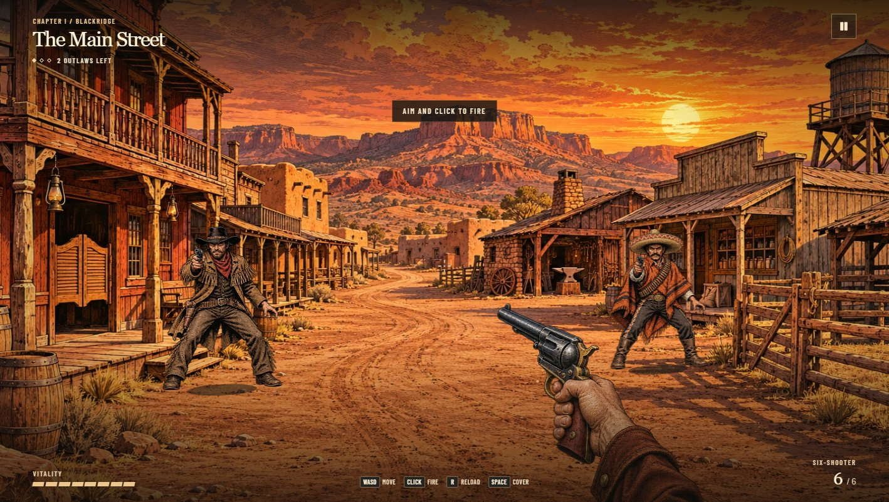

# Outlaws · Three Frontiers

Open `index.html` in a modern browser to play offline. Each chapter has three encounters and can be selected from the campaign screen. The game includes its artwork, fonts, sound synthesis, and controls in this folder.



## Playing the campaign

| Chapter | Character and weapon | How it plays |
| --- | --- | --- |
| Dust & Iron | Blackridge gunslinger · six-shooter | Fire six rounds, then reload. Take cover when an outlaw signals an attack. |
| Shadow of the Torii | Samurai of Kiso Valley · katana | Aim at a ninja or rōnin and strike. Four strikes use up the samurai’s focus. |
| Oath of the Alps | Waldstätter of Uri · halberd | Close with the Austrian soldiers until the reticle turns amber. Alternate sweeps and thrusts, then recover stamina. |

| Action | Desktop controls |
| --- | --- |
| Move and strafe | W, A, S, D |
| Aim and attack | Mouse and left click, or arrow keys and F |
| Select an opponent | Q |
| Take cover | Hold Space or C |
| Reload, center focus or recover stamina | R |
| Pause or resume | Esc or P |

On a touchscreen, tap opponents to attack and hold the on-screen movement or cover controls. Clearing an encounter advances the route. Completing the third encounter marks the chapter as cleared when you continue or return to the campaign.

## Technical notes

### Source layout

| File | Responsibility |
| --- | --- |
| [index.html](index.html) | Campaign screen, field guide, SVG interface icons and the container for combat. |
| [campaign.js](campaign.js) | Chapter selection, keyboard navigation, sound preference, fullscreen and saved progress. |
| [game.js](game.js) | Simulation, perspective projection, aiming, damage, weapon timing, rendering and synthesized audio. |
| [campaign.css](campaign.css) and [game.css](game.css) | Responsive menu, combat HUD, overlays, touch controls and reduced-motion styles. |
| [assets/](assets/) | Original chapter illustrations, landscapes, transparent opponent and weapon sprites, texture and bundled fonts. The Rye and Barlow Condensed font licenses are included here. |

### Rendering and combat

An HTML Canvas 2D renderer draws a painted landscape, then projects each opponent’s position onto the screen. Distance controls sprite height. The renderer draws distant opponents first and layers the player’s hand and weapon in the foreground. Movement pans and scales the landscape, while recoil and weapon recovery animate the foreground independently.

The simulation runs on `requestAnimationFrame`. It caps elapsed time per update at 50 ms and caps the canvas pixel ratio at 1.75. Switching away from an active encounter pauses it. Reduced-motion preferences tone down effects such as camera shake and walking motion.

A hit test compares the reticle with an ellipse scaled to each opponent’s on-screen size. Touch input gets a wider margin. The Swiss chapter also measures the soldier’s distance from the player. A halberd strike can only land within 4.4 game units, so stepping forward changes which targets you can hit.

### Sound and saved progress

The Web Audio API generates weapon cues and music using oscillators, filters and a noise buffer. Browser local storage holds the cleared chapter IDs under `three-frontiers.cleared` and the sound preference under `three-frontiers.sound`. An encounter in progress lives in memory. When storage is unavailable, progress remains usable for the current session.

### Running from a local server

Opening `index.html` directly is sufficient. To test over HTTP, run this command **from the ChatGPT folder** and visit [the local game](http://127.0.0.1:8000/).

```sh
python -m http.server 8000 --bind 127.0.0.1
```

The URL fragments `#west`, `#japan` and `#swiss` select a chapter on entry. The source runs as plain HTML, CSS and JavaScript with all runtime assets loaded through relative paths.
