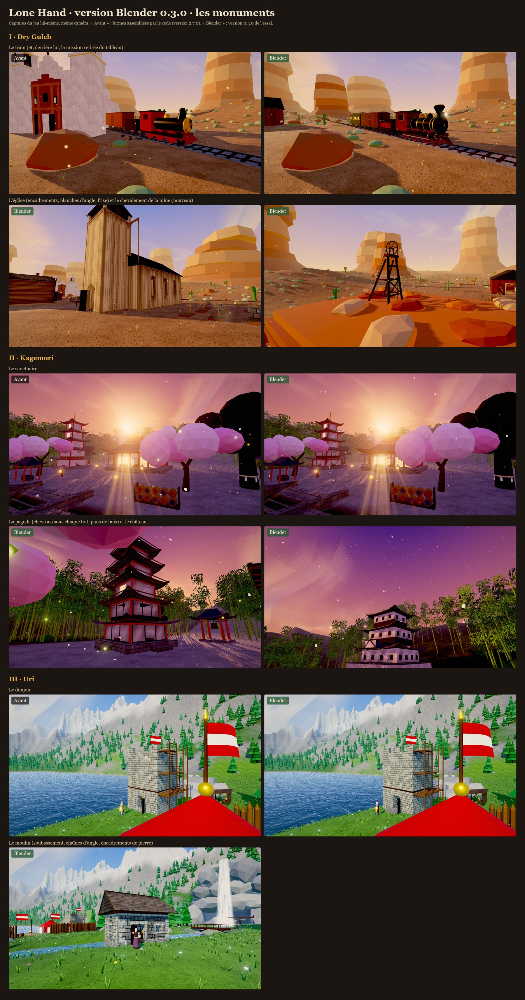

# Lone Hand — Blender trial

**Version 0.3.0** · [What changed (changelog)](CHANGELOG.md) · built from [Lone Hand 2.7.0](../Claude/)

A trial: what does *Lone Hand* look like when its people and its buildings come from
[Blender](https://www.blender.org/) instead of being put together from coloured shapes by the game's own code?
Three of the nine chapters are done this way, and only these three can be played here: **Dry Gulch**, **Kagemori**
and **Uri**. The other six are greyed out on the title screen; play them in [Lone Hand](../Claude/). The game
itself (rules, enemies, maps, online play) is that of Lone Hand 2.7.0.

**[Play it in your browser](https://iago-swi.github.io/outlaws/Claude-Blender/)**

The game of record is still [Lone Hand](../Claude/). Nothing in its folder was changed for this trial.

## What comes from Blender

| | Dry Gulch | Kagemori | Uri |
| --- | --- | --- | --- |
| People, **modelled** | all 12 looks: outlaws, the boss, the three heroes, the three duel villains, townspeople, the priest | all 14 looks: ninja, rōnin, archers, the Iron Rōnin, heroes, villains, villagers, komusō, geisha | all 13 looks: Habsburg soldiers, knights, the bailiff, heroes, villains, villagers, the monk |
| Houses, **modelled** | the 12 houses of Main Street, inside and out | the 6 houses built on one plan: tea house, farmhouses, dōjō, hermitage | the 2 chalets and the 4 barns on staddle stones |
| Everything else that stands, **reworked** | 1 686 shapes: church, station, barn, corral, water tower, windmill, mine, fences, bridge, furniture | 791 shapes: shrine, pagoda, castle, gates, bridges, lanterns, furniture | 1 067 shapes: chapel, keep, mill, camp, palisade, landing, tower, fences, furniture |

Two ways of using Blender, and the difference shows:

- **Modelled.** The people and the houses of one plan were designed anew in Blender scripts. Every figure is
  dressed from one library of parts on one skeleton: a body, a face, hair, 11 kinds of hat and helmet, 15 beards
  and hairstyles, 25 garments. The game picks the parts a look wears and colours them, as it does with its own
  shapes, so the random variety of the characters is kept; and the skeleton's joints sit exactly where the game's
  figures have theirs, so the game's own animation code moves them. The houses stand on the plans of the game's
  houses: clapboards, cornices, verandas, squared logs, curved roofs.
- **Reworked.** Everything else is still laid out by the game's own code, shape by shape; with `?dump` the game
  writes these shapes down, and Blender gives each one a better version by rule: a wooden wall, floor, door or
  table top becomes boards in relief, each a shade of its own; posts, beams and blocks have their edges planed
  off; cylinders get more sides; roofs get a thickness, boards underneath and barge boards; then shade is baked
  over the whole place, with dirt where things meet the ground. It is a finish, not a new design: the church is
  the same church, better made.

- **Landmarks, redrawn.** Ten places stand out and got more than the general rework: in Dry Gulch the church, the
  railroad (the station and the train), the water tower and the mine; in Kagemori the shrine, the pagoda and the
  castle; in Uri the chapel, the keep and the mill.
  - *The train* is modelled anew (`extras.py`): an engine with a banded boiler, a flared stack, domes, a bell, a
    headlamp, spoked wheels and a slatted cow-catcher; a tender heaped with coal; a boarded boxcar; a coach with lit
    windows. The game moves it as before.
  - *The mine* has something it never had: a headframe with its sheave wheel on the outcrop, and an ore cart on
    the rails.
  - *The water tower's tank* is a vat of staves bound with iron hoops.
  - *The buildings* are read back out of the game's shapes (`dress.py`): which wall pieces lie in one plane, where
    the plane has its doors and windows, which side is outside. Then each wall gets what the boxes never had, in
    the manner of the place: surrounds to doors and windows (pointed hoods on the wooden church, stone lintels and
    sills in Uri, dark frames in Kagemori), a plinth, a cornice, corner boards or quoins, a timber frame on
    plaster, rafters under every curved roof. The gain is plain on the church, the pagoda, the shrine and the mill;
    it is small on the castle and the keep, which are stacked blocks rather than walls with openings and would
    need a model of their own.

In both cases the game keeps its own colliders: you enter the same doors, climb the same ladders and stand on the
same roofs. The reworked wooden walls can still be shot through and broken, as in Lone Hand.

## What does not

- Terrain, trees and plants, rocks, animals, water, the sky.
- Weapons, in the hands of the figures and in the player's own; glass, cloth, paper screens, lamps.
- Small things that break at a touch (bottles, cups, tools) and what the levels made breakable themselves
  (crates, barrels, tables): they are the game's, and break as before.
- The walls of the *modelled* houses (Main Street, the chalets, the barns) cannot be shot through or broken:
  each house is one model.
- The mission of Dry Gulch is not in this version at all: a second church beside the first, it was taken out of the chapter here. It stands as ever in Lone Hand.
- Chapters IV to IX.
- The models were made by scripts, not by a sculptor's hand: they are tidier and richer than the shapes they
  replace, not the work of a 3D artist.

## Compare for yourself

Add these to the address of the game:

- `?classic` shows the same game without anything from Blender.
- `?level=1&pair` (or `2`, `3`) starts the chapter with all its looks in a row in front of you, each figure twice:
  as the game builds it (left) and from the Blender parts (right).

## Figures

Measured on the laptop named in Lone Hand's README (Intel Arc 140V), 1920 × 1080, high graphics, 30 enemies,
from the place where the chapter starts; two runs of three seconds each. The machine was warm: read the two
columns against each other, not against Lone Hand's own table.

| | Dry Gulch | Kagemori | Uri |
| --- | --- | --- | --- |
| Frames per second, Blender | 75 / 73 | 54 / 54 | 74 / 68 |
| Frames per second, classic | 90 / 90 | 59 / 59 | 80 / 77 |
| Triangles drawn, Blender | 2.04 million | 1.36 million | 2.95 million |
| Triangles drawn, classic | 0.95 million | 0.66 million | 2.01 million |
| Draw calls, Blender | 400 | 280 | 420 |
| Draw calls, classic | 830 | 590 | 850 |

| Model file | Contents | Size in the page |
| --- | --- | --- |
| `people.lhm` | 61 parts, 23 364 vertices, 35 848 triangles | 259 KB |
| `west.lhm` | 12 houses, the train, the headframe, the ore cart: 162 838 vertices, 185 492 triangles | 1 672 KB |
| `japan.lhm` | 6 houses, 33 241 vertices, 45 008 triangles | 374 KB |
| `swiss.lhm` | 2 chalets and a barn, 24 947 vertices, 31 774 triangles | 269 KB |
| `west-scenery.lhm` | 1 686 shapes, 122 594 vertices, 102 232 triangles | 820 KB |
| `japan-scenery.lhm` | 791 shapes, 98 520 vertices, 100 804 triangles | 915 KB |
| `swiss-scenery.lhm` | 1 067 shapes, 76 154 vertices, 66 642 triangles | 626 KB |

The game is still one file, `index.html`: 8.8 MB instead of 2.2 MB (5.7 MB instead of 0.9 MB when a web server
compresses it). Reading the models takes about 0.4 seconds when the game starts.

## Run it

Play online with the link above, or download this folder and open `index.html` in a current version of Chrome or
Edge (`Play.bat` on Windows). No installation and no internet connection are needed, except for games online.
How to play: see [Lone Hand's README](../Claude/README.md).

## Technical notes

- **Scripts, not files drawn by hand.** `source/blender/` holds the Python scripts that Blender 5.3 runs without
  its window: `people.py` (the library of parts), `town.py` (Main Street, from the options of the game's `bld()`,
  kept in `west.json`), `village.py` (the Japanese houses, the chalets, the barn), `extras.py` (the train, the headframe,
  the ore cart), `refine.py` (the rework of everything else, from `dump/<chapter>.json`), `dress.py` (the landmarks'
  walls and roofs), `lib.py` (lofts, lathes, the mesh), `pack.py` (shading and the
  model file). Blender bevels the woodwork and weights the normals; the scripts bake ambient occlusion into the
  vertices with Blender's ray casting.
- **The model file** (`.lhm`, see `pack.py`): positions as 16-bit numbers, normals and colours as bytes, deflated;
  about a tenth of the size of the same model as glTF. `source/src/blend.js` reads it with the browser's own
  `DecompressionStream`; no loader library is added to the game.
- **Modelled things in the game**: `makeHumanoid()` hands over to `blendHumanoid()` in the three chapters; a house
  is placed with `blendPlace()` and the game's own builder for it becomes a "ghost" that makes colliders only
  (`Builder.ghost`).
- **Reworked things in the game**: while a chapter is built, the builder sets the shapes of standing things aside
  (`Builder.capture`). Each shape has a signature (its material, its size and its place, to the centimetre); the
  model file holds the Blender version of every shape under the same signature, as a range of triangles of its
  own. A shape whose signature is found is replaced; one that is not goes into the scenery as it is, so nothing
  can go missing. A wall the game can break keeps its piece and is given the range of its Blender triangles.
- **To the game they are scenery like any other**: plain triangles in the game's own materials, so shots, lines of
  sight and standing on roofs work on them as before.
- **Build**: in `source/`, `"C:\Program Files\Blender Foundation\Blender 5.3\blender.exe" --background --factory-startup --python blender/build.py`
  writes `src/models/*.lhm`; then `npm ci` and `npx vite build` write `dist/index.html`. After a change to what a
  chapter builds, open the built game with `?level=1&dump` (2, 3): `game.blend.dump` then holds the shapes to save
  as `blender/dump/<chapter>.json`, and the scenery files are built again from them.
- **Licences**: as Lone Hand (`licenses/`). Blender is used as a tool; what it produces here is part of this project.
