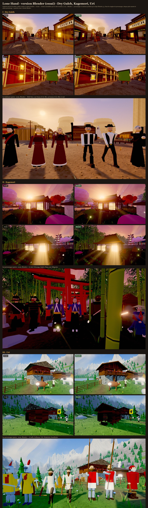

# Lone Hand — Blender trial

**Version 0.1.0** · [What changed (changelog)](CHANGELOG.md) · built from [Lone Hand 2.7.0](../Claude/)

A trial: what does *Lone Hand* look like when its people and its houses are modelled in
[Blender](https://www.blender.org/) instead of being put together from coloured shapes by the game's own code?
Three of the nine chapters are done this way: **Dry Gulch**, **Kagemori** and **Uri**. The other six
chapters, and the game itself (rules, enemies, maps, online play), are those of Lone Hand 2.7.0, unchanged.

**[Play it in your browser](https://iago-swi.github.io/outlaws/Claude-Blender/)**

The game of record is still [Lone Hand](../Claude/). Nothing in its folder was changed for this trial.

## What is modelled in Blender

| | Dry Gulch | Kagemori | Uri |
| --- | --- | --- | --- |
| People | all 12 looks: outlaws, the boss, the three heroes, the three duel villains, townspeople, the priest | all 14 looks: ninja, rōnin, archers, the Iron Rōnin, heroes, villains, villagers, komusō, geisha | all 13 looks: Habsburg soldiers, knights, the bailiff, heroes, villains, villagers, the monk |
| Houses | the 12 houses of Main Street, inside and out | the 6 houses built on one plan: tea house, farmhouses, dōjō, hermitage | the 2 chalets and the 4 barns on staddle stones |

Every figure is dressed from **one library of parts** on one skeleton: a body, a face, hair, 11 kinds of hat and
helmet, 15 beards and hairstyles, 25 garments. The game picks the parts a look wears and colours them, as it does
with its own shapes, so the random variety of the characters is kept. The skeleton's joints sit exactly where the
game's figures have theirs, so the game's own animation code moves the Blender figures: nothing was animated by hand.

The houses stand on the plans of the game's own houses and keep its colliders: you enter the same doors, climb the
same ladders and stand on the same roofs.

## What is not

- Everything else in the three chapters is still built by the game: the church, the mission, the station and the
  mine of Dry Gulch; the shrine, the pagoda, the castle, the gates and the bridges of Kagemori; the lake landing,
  the camp and the chapel of Uri; terrain, trees, animals, furniture, carts.
- Weapons, in the hands of the figures and in the player's own, are the game's.
- The walls of a Blender house cannot be shot through or broken, as wooden walls can in Lone Hand: each house is
  one model. The paper screens of the Japanese houses are still the game's, and still break.
- The models were made by scripts, not by a sculptor's hand: they are tidier and richer than the shapes they
  replace, not the work of a 3D artist.

## Compare for yourself

Add these to the address of the game:

- `?classic` shows the same game without any Blender model.
- `?level=1&pair` (or `2`, `3`) starts the chapter with all its looks in a row in front of you, each figure twice:
  as the game builds it (left) and from the Blender parts (right).

## Figures

Measured on the laptop named in Lone Hand's README (Intel Arc 140V), 1920 × 1080, high graphics, 30 enemies,
from the place where the chapter starts; two runs each, which differ by up to 15 frames.

| | Dry Gulch | Kagemori | Uri |
| --- | --- | --- | --- |
| Frames per second, Blender | 97 / 81 | 64 / 63 | 83 / 85 |
| Frames per second, classic | 109 / 95 | 66 / 65 | 92 / 76 |
| Triangles drawn, Blender | 1.88 million | 1.21 million | 2.85 million |
| Triangles drawn, classic | 0.95 million | 0.66 million | 2.01 million |
| Draw calls, Blender | 430 | 310 | 410 |
| Draw calls, classic | 810 | 620 | 860 |

| Model file | Contents | Size in the page |
| --- | --- | --- |
| `people.lhm` | 61 parts, 23 364 vertices, 35 848 triangles | 259 KB |
| `west.lhm` | 12 houses, 137 160 vertices, 162 872 triangles | 1 474 KB |
| `japan.lhm` | 6 houses, 33 241 vertices, 45 008 triangles | 374 KB |
| `swiss.lhm` | 2 chalets and a barn, 24 947 vertices, 31 774 triangles | 269 KB |

The game is still one file, `index.html`: 5.4 MB instead of 2.2 MB (3.2 MB instead of 0.9 MB when a web server
compresses it). Reading the models takes about 0.15 seconds when the game starts.

## Run it

Play online with the link above, or download this folder and open `index.html` in a current version of Chrome or
Edge (`Play.bat` on Windows). No installation and no internet connection are needed, except for games online.
How to play: see [Lone Hand's README](../Claude/README.md).

## Technical notes

- **Scripts, not files drawn by hand.** `source/blender/` holds the Python scripts that Blender 5.3 runs without
  its window: `people.py` (the library of parts), `town.py` (Main Street, from the options of the game's `bld()`,
  kept in `west.json`), `village.py` (the Japanese houses, the chalets, the barn), `lib.py` (lofts, lathes, the
  mesh), `pack.py` (shading and the model file). Blender bevels the woodwork, weights the normals, and the scripts
  bake ambient occlusion into the vertices with Blender's ray casting.
- **The model file** (`.lhm`, see `pack.py`): positions as 16-bit numbers, normals and colours as bytes, deflated;
  about a tenth of the size of the same model as glTF. `source/src/blend.js` reads it with the browser's own
  `DecompressionStream`; no loader library is added to the game.
- **In the game**: `makeHumanoid()` hands over to `blendHumanoid()` in the three chapters; a house is placed with
  `blendPlace()` and the game's own builder for it becomes a "ghost" that makes colliders only
  (`Builder.ghost`). The Blender houses are plain triangles in the game's own materials, so shots, lines of sight
  and standing on roofs work on them as on the game's scenery.
- **Build**: in `source/`, `"C:\Program Files\Blender Foundation\Blender 5.3\blender.exe" --background --factory-startup --python blender/build.py`
  writes `src/models/*.lhm`; then `npm ci` and `npx vite build` write `dist/index.html`.
- **Licences**: as Lone Hand (`licenses/`). Blender is used as a tool; what it produces here is part of this project.
