# Lone Hand — Claude version

A first-person shooter in eight chapters, built with Claude (Anthropic) in the spirit of
late-1990s Western shooters. From a frontier town to a Japanese shrine, an alpine valley,
a Greek island, a Norwegian fjord, a village in Normandy in 1944, a Soviet city in 1974
and the Tibetan plateau in 1959, one hero faces many enemies alone, in a real-time 3D
world you can walk through freely. Most buildings can be entered, the longships at
Jarnvik can be boarded, and every chapter has places to climb, by a ladder or by steps of rock, and to crawl
into for an ambush. Twenty-four heroes from history and legend are playable, three per
chapter. In Duel mode two players fight each other online, as a hero or as one of
twenty-seven villains.

The whole game is one file, `index.html`. Every texture, model, sound and piece of music
is generated in the browser when the game starts; there are no image, model or audio
files.

**[Play it in your browser](https://iago-swi.github.io/outlaws/Claude/)**

| Chapter I · Dry Gulch | Chapter II · Kagemori |
| :---: | :---: |
| 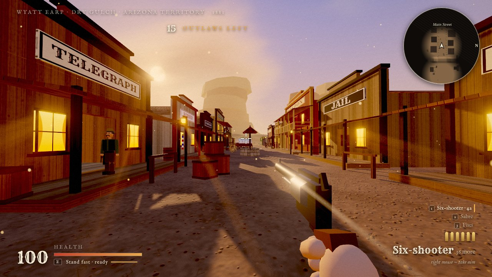 | 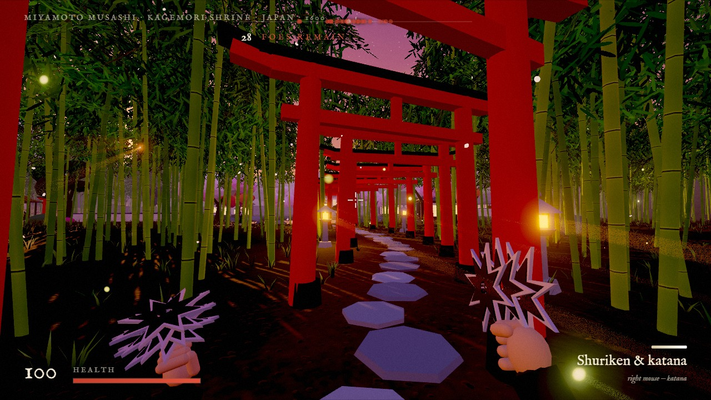 |
| **Chapter III · Uri** | **Chapter IV · Ithaca** |
| 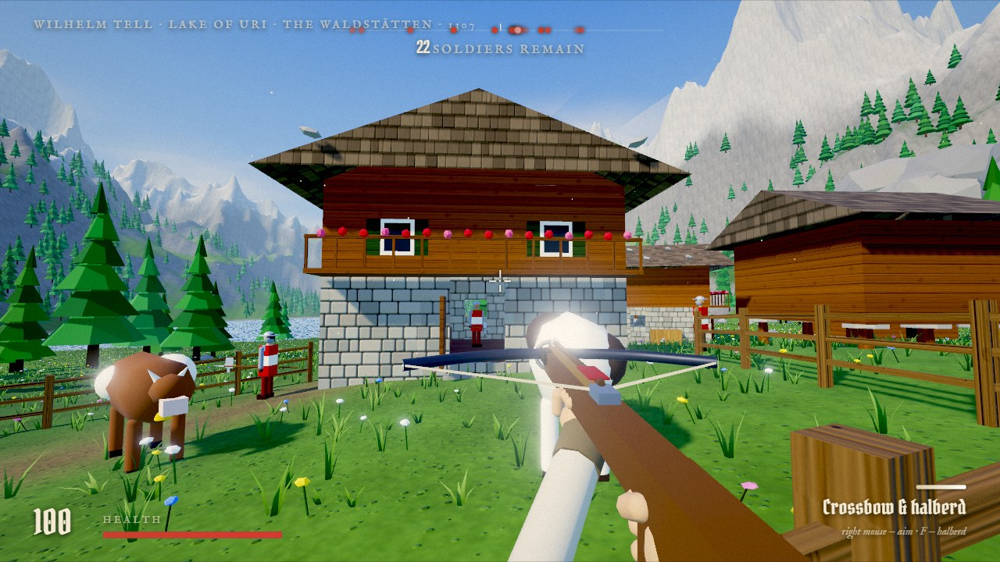 | 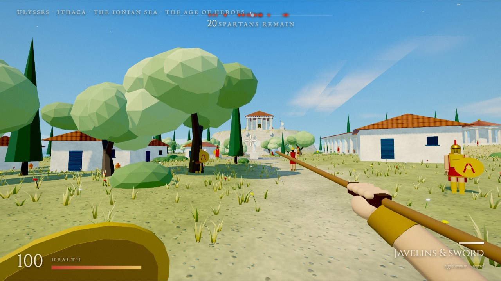 |
| **Chapter V · Jarnvik** | **Chapter VI · Sainte-Aubine** |
| 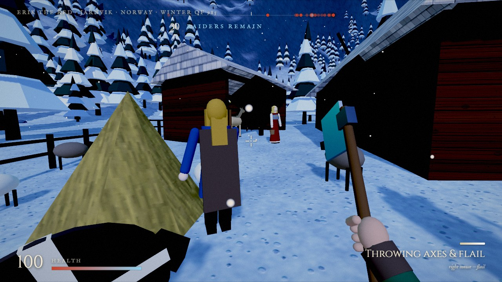 | 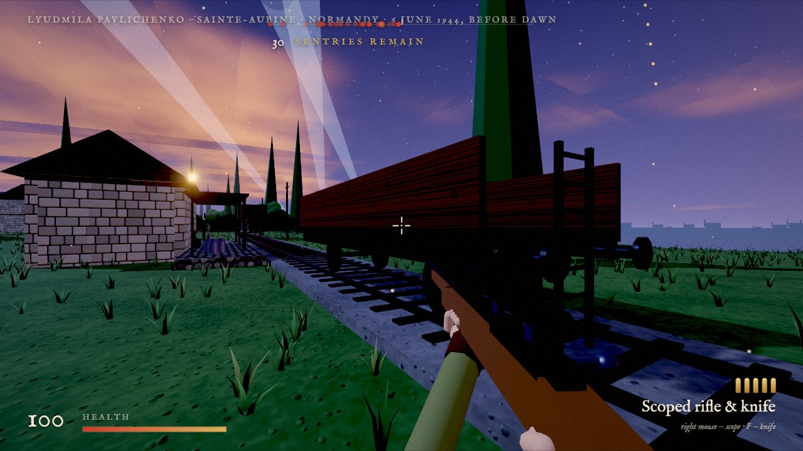 |
| **Chapter VII · Stalnogorsk** | **Chapter VIII · Che La** |
| 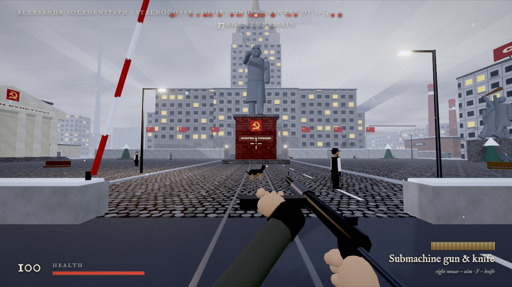 | 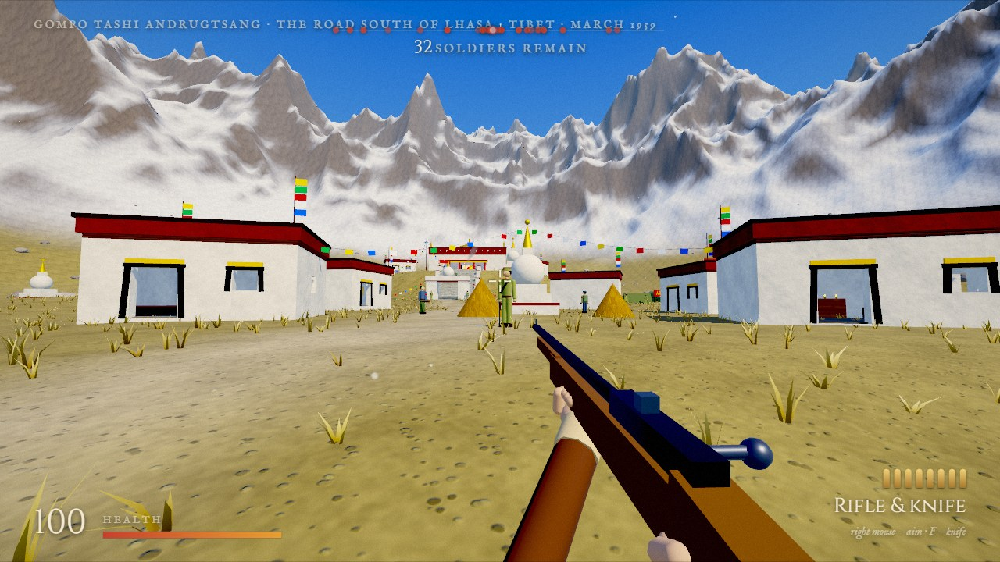 |

| Duel · choose your fighter | Duel · face to face |
| :---: | :---: |
| 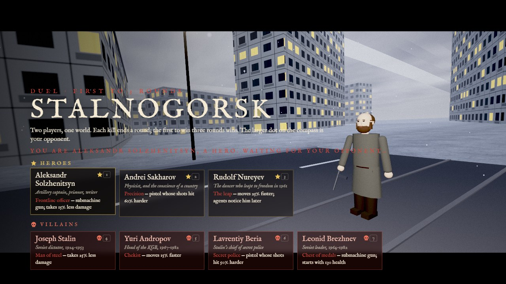 | 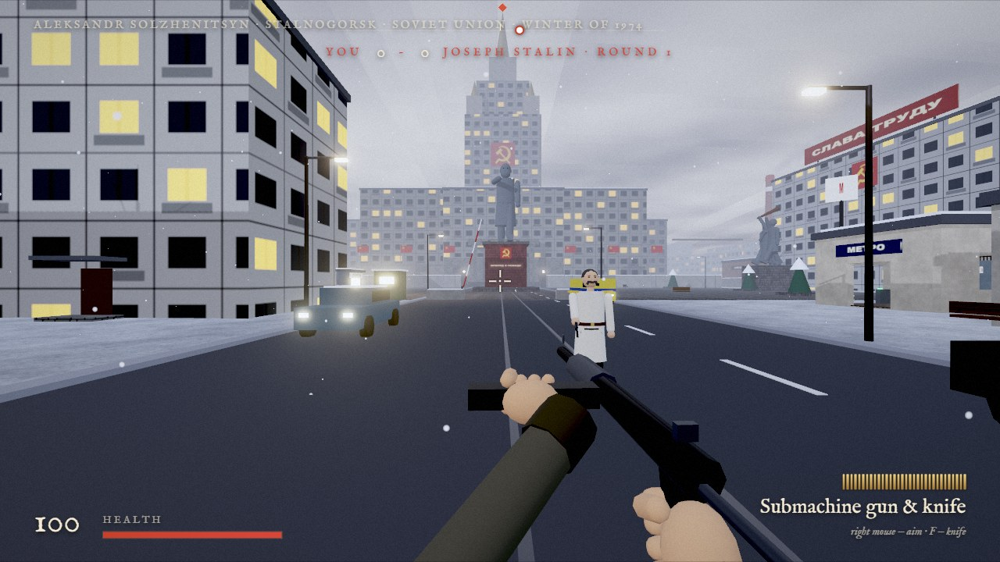 |

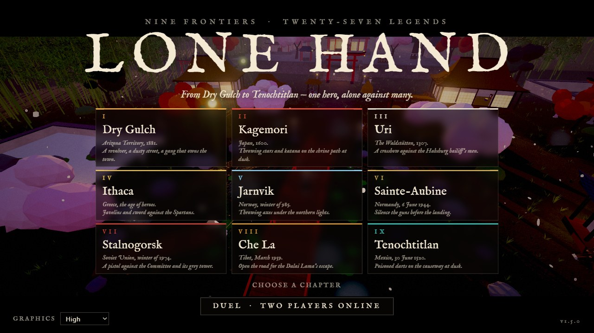

## Run it

Play online with the link above. To play offline, download the folder and open
`index.html` in a current version of Chrome or Edge, or double-click `Play.bat` on
Windows. No installation, build step, web server or internet
connection is needed, except for Duel mode. A mouse and keyboard are required; there are
no touch controls.

The title screen shows a different chapter behind it on every visit, and takes that
chapter's accent colour and lettering.

## How to play

Clear every enemy to finish a chapter. The dots on the compass at the top of the screen
show where the remaining enemies are; the last three come looking for you. Health items
(tonic, rice cake, alp cheese, ambrosia, mead, calvados, hot tea, butter tea) restore
35 points.

| Chapter | Weapons | Enemies |
| --- | --- | --- |
| I · Dry Gulch, Arizona Territory, 1881 | six-shooter | 31: cowboys, sombrero bandits, the gang boss Silas Crowe |
| II · Kagemori, Japan, 1600 | bow (yumi) and katana | 28: ninja who ambush from smoke, rōnin, archers, the Iron Rōnin |
| III · Uri, the Waldstätten, 1307 | crossbow and halberd | 27: Habsburg halberdiers, crossbowmen, knights, the bailiff |
| IV · Ithaca, Greece, the age of heroes | javelins and short sword | 30: Spartan hoplites, javelin throwers, their captain |
| V · Jarnvik, Norway, winter of 985 | throwing axes and sword | 34: rival Vikings, berserkers, bowmen, chieftains in horned helmets, the grey jarl |
| VI · Sainte-Aubine, Normandy, 6 June 1944 | scoped rifle, Sten gun or pistol, and a knife | 33: German riflemen, officers, machine-gunners, guard dogs, the battery commander |
| VII · Stalnogorsk, Soviet Union, winter of 1974 | submachine gun or pistol, and a knife | 37: KGB agents, militia with submachine guns, guard dogs, Colonel Voronin |
| VIII · Che La, Tibet, March 1959 | rifle or pistol and a knife, or bow and sword | 35: Chinese riflemen, machine-gunners, Red Guards, Commander Zhao |

### Places you can go into, onto and behind

Walls, furniture, iron bars and living bodies are solid for the player and for enemies,
and some enemies wait indoors, on deck or behind the waterfall.

| Chapter | Open buildings and other places |
| --- | --- |
| I | saloon, jail with two barred cells, bank with its safe, barn, a homestead, the crypt on Boot Hill (the cemetery outside town); the church, with its nave, a choir gallery and a stair inside the tower up to the bell; general store, sheriff's office with a cell, livery stable with a horse, blacksmith's forge, undertaker's, telegraph office |
| II | every house (walk-through, with open screens), the shrine hall, the dojo in its walled compound, a hermitage; the ground floor of the pagoda, a storehouse, the bell tower; the arched bridge over the pond |
| III | the chalets, the chapel, a Habsburg watchtower; the barns on their stone stilts, which hold hay, cheese or tools, and a drive-through hay barn; the ledge behind the waterfall |
| IV | every house, the temple's inner room with a golden Athena, the beacon tower on the fishermen's cape; a villa with a colonnaded court and a pool, the theatre with its stage house, the olive grove with its press |
| V | every longhouse, the jarl's great hall, a small temple of the old gods; a boat shed, an open smithy; four longships to board by gangplank: two at the jetty, your own on the beach and the jarl's great ship with a tent on deck |
| VI | the ground floor of every house, the command bunker, the manor, the windmill; the church, now a roofless ruin after the bombing; a farm barn |
| VII | the food shop, two garages, the Palace of Culture with its stage, the works, and the Committee building: lobby, cells and archive; a metro pavilion with turnstiles, the district library with its rows of shelves, a building site with a concrete slab to climb and the builders' hut |
| VIII | the village houses, the old fort, the monks' houses and the monastery's assembly hall; the village temple, the chapel of the great prayer wheel, a nomad tent of black yak hair |

Things to find on the way: mosaic floors and a bronze Athena in Ithaca; the hammer and
sickle on the flags, the monument, the palace and the tower of Stalnogorsk; a gilded
Buddha in each of the three temples of Che La; bomb craters in Sainte-Aubine. In Kagemori
three flute monks (komusō), their heads hidden under basket hats, and four geisha under
oil-paper umbrellas stand about the valley; like the Dalai Lama's caravan in chapter
VIII they are bystanders and take no part in the fight.

### Climb, jump and hide

Press `C` to crouch. A crouching player moves at half speed, is noticed
from 40% less far, is hidden by anything about a metre high, and fits through low doors.
Ladders need no key: face one and walk into it, and you climb; at the top you step onto
the roof or the deck. A jump clears about 1.3 m.


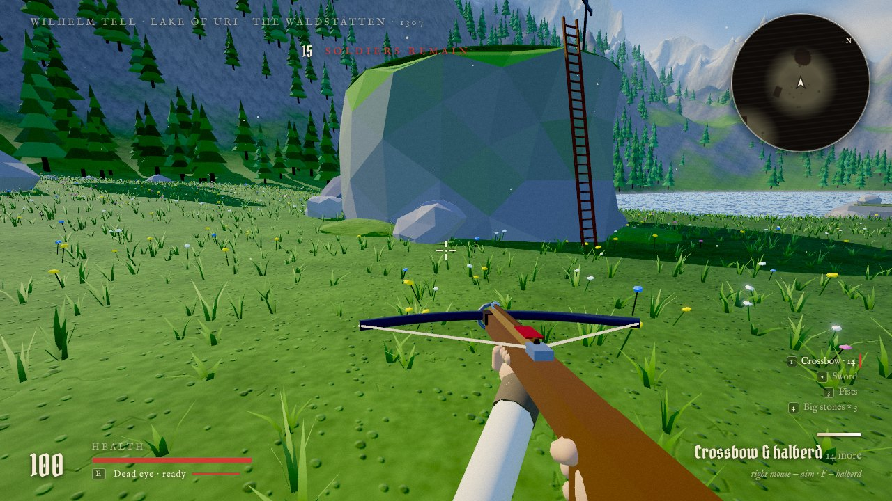

| Chapter | Places for an ambush or a sniper |
| --- | --- |
| I | Lookout Butte south of town, 12 m high, climbed by a zigzag of rock steps, with boulders on top to crouch behind; the flat roofs of the general store, the sheriff's office, the blacksmith and the telegraph office, each reached by a ladder at the back; a root cellar with a crawl-in door; the low walls of a ruined adobe; the church tower: a stair to the choir gallery, then a square spiral of steps inside the tower to the belfry, 11 m up, with a parapet to crouch behind |
| II | a watch platform in the dojo court; a tea hut whose door is a crawl-in hatch |
| III | a great boulder in the meadow west of the path, 7.5 m high, with a flat grassy top and a summit cross of dark iron, reached by a wooden ladder that leans against its flank; a hunter's high seat near the start |
| IV | a lookout above the landing beach; an old cistern to crawl into |
| V | a watch platform in the village; an earth cellar; the decks of the longships |
| VI | a hunter's stand among the hedgerows; a dugout; the ruined church |
| VII | the roofs of the garages (a ladder, then along the whole row); a cellar hatch; the slab of the building site |
| VIII | a lookout beside the road; a hermit's cell |

Every watch platform, lookout, high seat and hunter's stand has a ladder too.
Enemies can follow you up anything that has steps: the butte can be
stormed. Both the butte and the boulder are held by a marksman when you arrive. Enemies cannot climb ladders or jump, so roofs,
platforms and high seats are safe from blades, though not from bullets, and they cannot
get through a crawl-in door at all. The church tower is an exception among the stairs:
it has two storeys above its ground floor, and the route grid knows one floor per spot,
so enemies stay below and the bandit in the belfry holds his post.

### Choose your hero

Each chapter starts with a choice of three heroes from history and legend. Point at a
card to see the figure in the opening shot, then click it, or press `1` to `3` and
`Enter`. Every hero has their own look and one strength; in chapters VI to VIII the heroes
also carry different weapons.

Above the cards, the **Enemies** list sets how many enemies the chapter holds: all of
them (the default), or any number from 10 to 30, as far as the chapter has that many.
The boss always stays; the others are chosen evenly through the chapter, so the whole map
remains guarded. The choice is kept for the next chapter and when you retry.

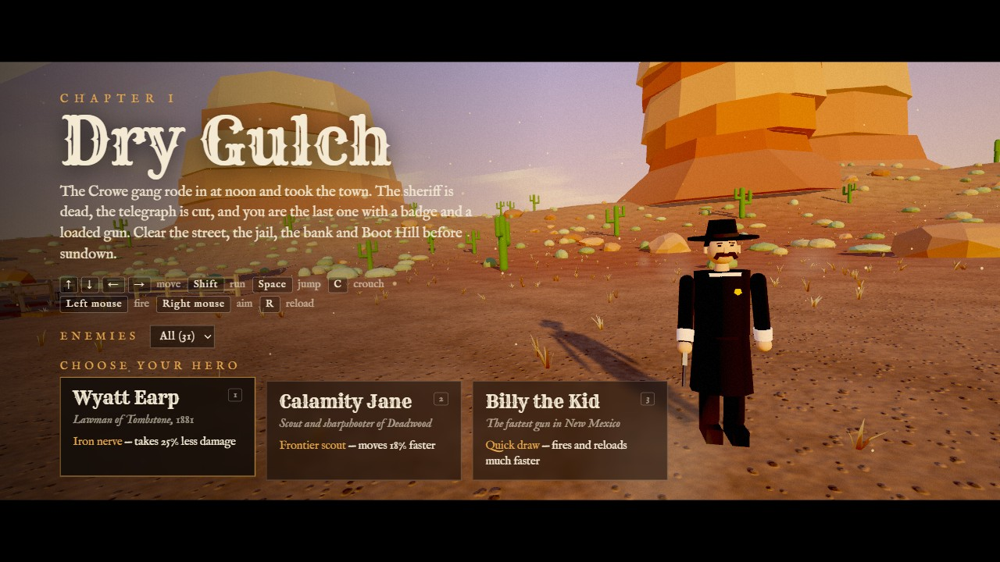

| Chapter | Hero | Who | Strength |
| --- | --- | --- | --- |
| I | Wyatt Earp | Lawman of Tombstone, 1881 | Iron nerve: takes 25% less damage |
| I | Calamity Jane | Scout and sharpshooter of Deadwood | Frontier scout: moves 18% faster |
| I | Billy the Kid | The fastest gun in New Mexico | Quick draw: fires and reloads much faster |
| II | Miyamoto Musashi | Undefeated duellist, master of two swords | Two swords: faster katana cuts with longer reach |
| II | Tomoe Gozen | Woman warrior of the Genpei War | Peerless archer: draws the bow almost twice as fast |
| II | Date Masamune | The One-Eyed Dragon of Sendai | Black armour: takes 30% less damage |
| III | Wilhelm Tell | The crossbowman of Bürglen, Uri | Master shot: reloads the crossbow 40% faster |
| III | Arnold von Winkelried | Hero of Sempach, from Nidwalden | Breaks the line: starts with 150 health |
| III | Werner Stauffacher | Man of Schwyz, of the Rütli oath | Steadfast: slowly recovers health out of danger |
| IV | Ulysses | King of Ithaca, the man of many wiles | Sure aim: javelins fly faster and hit harder |
| IV | Achilles | Greatest warrior of the Trojan War | Nearly invulnerable: takes 35% less damage |
| IV | Heracles | Strongest of heroes, of the twelve labours | Strength of ten: starts with 170 health |
| V | Erik the Red | Outlaw and founder of Greenland | Hot temper: throws axes much faster |
| V | Leif Erikson | Leif the Lucky, who sailed to Vinland | The Lucky: takes 30% less damage |
| V | Ragnar Lothbrok | Legendary sea-king and raider | Raider: faster, harder sword blows |
| VI | Lyudmila Pavlichenko | Soviet sniper, 309 confirmed kills | Sniper: scoped rifle, one shot fells a soldier |
| VI | Virginia Hall | American spy, “the limping lady” | Spy: Sten gun; sentries notice her much later |
| VI | Maurice Bavaud | Of Neuchâtel, who set out to shoot Hitler in 1938 | Sure hand: pistol whose shots hit 60% harder |
| VII | Aleksandr Solzhenitsyn | Artillery captain, prisoner, writer | Frontline officer: submachine gun; takes 15% less damage |
| VII | Andrei Sakharov | Physicist, and the conscience of a country | Precision: pistol whose shots hit 60% harder |
| VII | Rudolf Nureyev | The dancer who leapt to freedom in 1961 | The leap: moves 25% faster; agents notice him later |
| VIII | Gompo Tashi Andrugtsang | Khampa leader of the Chushi Gangdruk | Marksman: rifle, one shot fells a soldier |
| VIII | Ani Pachen | The warrior nun who led her clan on horseback | Rider: pistol; moves 20% faster |
| VIII | Songtsen Gampo | The king who founded the Tibetan empire | King of old: bow and sword; takes 20% less damage |

The heroes are drawn from history, myth and saga, not from any film, series or comic.
Several do not belong to their chapter's year or place (Winkelried is of 1386, Tomoe
Gozen of the twelfth century, Ragnar of the ninth; in 1944 Pavlichenko was on the
Eastern Front and Bavaud had been executed three years earlier); they appear as legends
beside the others.

Chapter VI is set in occupied France. Its three heroes are real people who resisted the
Nazi regime, and they are shown with respect. The chapter shows no Nazi symbols: vehicles
and the flag carry a plain bar cross.

Chapter VII is set in Stalnogorsk, an invented Soviet city. Its three heroes are real
people who stood against the Soviet state, and none of them ever fought it with a gun:
Solzhenitsyn was expelled from the country in 1974, Sakharov was banished to Gorky in
1980, and Nureyev had left in 1961. The mission, to bring a seized manuscript out of the
Committee's tower, is fiction. The hammer and sickle hangs on the flags and public
buildings, as it did in any Soviet city of that year.

Chapter VIII follows a real event: the Dalai Lama's escape from Lhasa in March 1959. He
stands with his caravan where the chapter starts, unarmed, and is never part of the
fighting; the player clears the road ahead of him. Gompo Tashi Andrugtsang and Ani Pachen
did fight in those years; Songtsen Gampo is a king of the seventh century. The Red Guards
belong to the years after 1966 and are in the chapter by request, not by the calendar.

### Duel: two players online

Click **Duel** on the title screen. Two players, each on their own computer, hunt each
other in one of the eight chapters; the goal is to kill the other player.

1. One player chooses the chapter, the rules and how many computer enemies stay in
   the world (none, or one to nine), then clicks *Create and get the invite link*.
2. They send the link, or its five-letter code, to the other player, who opens it.
3. Both choose a fighter. The duel starts when both have chosen.
4. After a duel the two players stay connected. A click on the end screen leads back to
   the Duel screen, where the host picks the next chapter and rules and starts again.
   No new link or code is needed until one of the players leaves.

| Rule | How it ends |
| --- | --- |
| First to 3 rounds | Each kill ends a round. Both players start again with full health, at opposite ends of the map, and change ends every round. |
| One life | The first kill decides. |
| 5 minutes, most kills | A player comes back three seconds after dying, at the end of the map farther from the opponent. |

In a duel each chapter offers its villains beside its three heroes. Heroes stand in a
row marked with a gold star, villains in a row marked with a red skull, and every card
carries the same mark. Like a hero, a villain has their own look and one strength.

| Chapter | Villain | Who | Strength |
| --- | --- | --- | --- |
| I | Jesse James | Bank and train robber of Missouri | Train robber: moves 15% faster |
| I | Ike Clanton | Rustler of Tombstone, Earp's enemy at the O.K. Corral | Rustler: starts with 130 health |
| I | Belle Starr | The Bandit Queen of Indian Territory | Two guns: fires 30% faster |
| II | Oda Nobunaga | Warlord, the Demon King of the Sixth Heaven | Warlord: takes 25% less damage |
| II | Sasaki Kojirō | Musashi's rival, master of the long sword | The Drying Pole: the katana reaches 0.8 m further |
| II | Fūma Kotarō | Leader of the Fūma ninja clan | Night raider: moves 20% faster |
| III | Hermann Gessler | Habsburg bailiff of Uri, of the hat on the pole | Bailiff: takes 20% less damage |
| III | Charles the Bold | Duke of Burgundy, beaten at Grandson, Murten and Nancy | Burgundian steel: starts with 150 health |
| III | Duke Leopold I | Habsburg duke, routed at Morgarten in 1315 | Knight: halberd thrusts hit 40% harder |
| IV | Polyphemus | The Cyclops, son of Poseidon | Giant: starts with 180 health, but is a large target |
| IV | Medusa | The Gorgon whose gaze turns men to stone | Deadly gaze: javelins fly faster and hit harder |
| IV | Antinous | Leader of the suitors in Ulysses' hall | Usurper: moves 15% faster |
| IV | Minotaur | The bull-headed monster of the Cretan labyrinth | Bull of Minos: throwing axes and sword; starts with 160 health |
| IV | Xerxes | Great King of Persia, who invaded Greece in 480 BC | King of Kings: bow and sword; takes 20% less damage |
| V | Erik Bloodaxe | King of Norway, slayer of his brothers | Bloodaxe: throws axes much faster |
| V | Ivar the Boneless | Ragnar's son, leader of the Great Heathen Army | Cunning: takes 25% less damage |
| V | Loki | Trickster god, father of the wolf Fenrir | Shape-shifter: moves 20% faster |
| VI | Adolf Hitler | Dictator of Nazi Germany, 1933–1945 | Dictator: pistol; takes 20% less damage |
| VI | Benito Mussolini | Fascist dictator of Italy, 1922–1943 | Strongman: Sten gun; starts with 120 health |
| VI | Hermann Göring | Head of the Luftwaffe, Hitler's deputy | Huntsman: scoped rifle |
| VII | Joseph Stalin | Soviet dictator, 1924–1953 | Man of steel: takes 25% less damage |
| VII | Yuri Andropov | Head of the KGB, 1967–1982 | Chekist: moves 15% faster |
| VII | Lavrentiy Beria | Stalin's chief of secret police | Secret police: pistol whose shots hit 50% harder |
| VII | Leonid Brezhnev | Soviet leader, 1964–1982 | Chest of medals: submachine gun; starts with 130 health |
| VIII | Mao Zedong | Chairman of Communist China, 1949–1976 | Chairman: rifle; takes 20% less damage |
| VIII | Langdarma | The king who persecuted the Dharma, 9th century | Horned king: bow and sword; starts with 140 health |
| VIII | Jiang Qing | Madame Mao, leader of the Gang of Four | Red Guard: pistol; moves 20% faster |

The villains can only be played in a duel. Chapter IV has five of them, chapter VII four,
the others three. The dictators are there to be fought: their figures carry no party
symbols, and each has a plain description of who they were. Several
villains, like several heroes, do not belong to their chapter's year.

Things to know in a duel:

- The whole map is used. The larger dot on the compass is your opponent.
- Weapons do 60% of their usual damage against the other player, so a duel is not over
  in one hit. A hit to the head still counts two and a half times.
- If computer enemies are in the world, there are as many as the host chose, one to
  nine; they attack whichever player is nearer, and being killed by one counts for your opponent.
- A duel cannot be paused, and practice mode is switched off.

**Connecting.** The two browsers talk to each other directly. The invite link uses a
free public service (PeerJS) only to introduce them; nothing of the game passes through
it. Each player can see the other's network address, as in any direct connection. If the
invite link fails, open *Connect with copy-paste codes* on the Duel screen: one player
makes a code, the other pastes it and sends a reply code back, and no outside service is
involved. On some company or mobile networks neither way gets through, because the game
has no relay server.

### Controls

| Key | Action |
| --- | --- |
| `↑` `↓` `←` `→` | Move: forward, back, sidestep left and right. `W` `A` `S` `D` do the same. The mouse turns the view |
| `Shift` | Run |
| `Space` | Jump (about 1.3 m). Also stands you up from a crouch |
| `↑`, facing a ladder | Climb it (no extra key) |
| `C` | Crouch on and off |
| Left mouse button | Fire, loose an arrow, shoot a bolt, throw a javelin or an axe |
| Right mouse button | Aim (six-shooter, crossbow, the guns of chapters VI to VIII; through the scope with the sniper rifle); katana or sword cut in chapters II, IV and V and with the bow of chapter VIII |
| `F` | Halberd thrust in chapter III, knife in chapters VI to VIII (also the katana and the swords) |
| `R` | Reload the six-shooter and the guns of chapters VI to VIII |
| `Esc` | Pause; then `Q` returns to the chapter list. `P` also pauses when the browser has not captured the mouse |
| `M` | Sound on/off |

The hero selection is shown over a short shot that circles the chosen figure; when the
chapter begins the view drops into first person. The hero's name stays in the top-left
corner, and the same hero is kept when you retry after dying.

<details>
<summary>Easter egg (spoiler)</summary>

Type `PAX` at any time, on any screen, to switch practice mode on or off. Enemies still
see, chase and attack you, but nothing they do can hurt you. While it is on, an olive
branch with the word PAX shows in the top-right corner and the health bar turns pale
green. The end-of-chapter screen notes that the result was reached in practice mode.

</details>

## Technical notes

### Stack

| | |
| --- | --- |
| Delivery | One `index.html` of 1.66 MB: markup, CSS, JavaScript, GLSL and four fonts, all inlined. Most of the size is the three.js library. |
| Source | About 7,800 lines of plain JavaScript (ES modules) in 20 files under [source/src/](source/src/), plus 270 lines of HTML and CSS. No framework. |
| Rendering | [three.js](https://threejs.org/) 0.187 on WebGL 2, with custom GLSL for the sky, water, waterfall, particles, wind and the final screen pass. HTML and CSS for the HUD and menu screens. |
| Sound | Web Audio API. Every effect and all music is synthesised. |
| Network | Duel mode only: a WebRTC data channel straight between the two browsers. [PeerJS](https://peerjs.com/) 1.5 and its public broker make the introduction for the invite link. |
| Build | [Vite](https://vite.dev/) 8 with `vite-plugin-singlefile`, which folds scripts, styles and fonts into the one HTML file. |
| Type | Rye, Pirata One, IM Fell English and Cinzel (SIL Open Font License), bundled through Fontsource. |
| Storage | None. Progress is not saved; all eight chapters are open from the start. |
| Requirements | A browser with WebGL 2 and half-float render targets. A dedicated graphics card is recommended. |

### Source layout

| File | Responsibility |
| --- | --- |
| [main.js](source/src/main.js) | Game loop, level loading, hero selection, combat rules, win and death, practice mode, HUD, menu screens, opening camera. |
| [gfx.js](source/src/gfx.js) | Renderer, sky dome (clouds, stars, northern lights), sun and shadows, bloom, final screen pass, particles, water and wind shaders. |
| [tex.js](source/src/tex.js) | Procedural textures and the shared material library. |
| [build.js](source/src/build.js) | Geometry helpers, the mesh-merging `Builder`, terrain height field, collision, ray casting, and the navigation grid with its route search. |
| [actors.js](source/src/actors.js) | Character builder, hero and enemy looks, the dog rig, enemy behaviour, projectiles. |
| [player.js](source/src/player.js) | Mouse and keyboard input, first-person movement, hero strengths, the weapon view models. |
| [audio.js](source/src/audio.js) | Sound effects, ambience and generative music. |
| [props.js](source/src/props.js) | Instancing helper, fences, barrels, grass, trees, horses, ships, fire bowls, and the builders for enterable rooms, flights of steps, iron bars, shelves, rubble, the longship you can board, the climbable butte with its zigzag stair, the great boulder with its leaning ladder and summit cross, ladders, raised hides and crawl-in dens. |
| [levels/](source/src/levels/) | One file per chapter: terrain, buildings, vegetation, enemy and item placement, lighting mood. |
| [duel.js](source/src/duel.js) | Duel mode: the other player's figure, rounds and scores, the messages between the two games, the lobby. |
| [net.js](source/src/net.js) | The connection between the two browsers: invite link through PeerJS, or two codes pasted by hand. |
| [villains.js](source/src/villains.js) | The twenty-seven villains that can be played in a duel. |
| [util.js](source/src/util.js) | Seeded random numbers and value, fractal and ridged noise. |

### Rendering pipeline

Each frame is drawn in this order:

1. **Shadow map.** One directional light (the sun, or the moon in chapters V and VI)
   renders a 4096 × 4096 shadow map covering 70 to 95 m around the camera. The light follows the camera in 4 m steps so
   shadow edges do not crawl.
2. **Scene.** The world is rendered into a half-float (HDR) target with 4× multisampling.
   Lighting is the sun, a sky/ground hemisphere light, and a blurred environment map
   baked from the sky shader when a level loads, so metal has something to reflect.
   Lanterns, fires and lamps are point lights without shadows: nine in chapter II, seven
   or fewer in the others.
3. **Bloom.** three.js `UnrealBloomPass` with a threshold between 1.0 and 1.5, set per
   chapter, so only
   values brighter than white glow: the sun, lit windows, lanterns, muzzle flashes.
4. **Final pass.** A single fragment shader applies, in order: light shafts, exposure,
   ACES tone mapping, saturation and contrast, split toning (separate tints for shadows
   and highlights), a vignette, the red damage and green healing overlays, gamma, and
   film grain.

The light shafts are a radial blur. For each pixel the shader takes 36 samples along the
line to the sun's position on screen and adds up the ones brighter than a threshold.
Anything standing in front of the sun therefore blocks its own streak, with no depth
buffer needed.

The sky is a dome shader: a vertical gradient, a glow and an over-bright disc for the
sun, five-octave fractal-noise clouds shaded by comparing the noise with a copy shifted
toward the sun, and stars and a moon for the dusk and night chapters. The northern
lights of chapter V are a further layer: a band of fractal noise stretched across the
northern sky, folded by a sine wave into curtains, green below and violet above. They
are brighter than white, so the bloom pass makes them glow. In that chapter the single
directional light is the moon.

In chapter VI the lamp that lights the scene is decoupled from the sun drawn in the sky.
The sun sits on the horizon and gives the dawn glow and the light shafts, while a cool
moonlight from behind the player casts the shadows; lit by the low sun alone the ground
was nearly black. The searchlight beams are long additive cones that rotate slowly, the
anti-aircraft fire is bursts of glowing particles far over the sea, and the fleet is a
row of dark boxes on the horizon.

Water is a second shader. Three scrolling noise layers give a surface normal; the
reflection is the sky gradient evaluated in the reflected direction plus a sharp sun
glint, mixed with a deep colour by a Fresnel term. The waterfall is a ribbon with
scrolling noise: it runs down the rock, leaps from an overhang and falls free, and it
is half transparent, so the valley shows through it from the ledge behind.

### Procedural textures

The wood planks, plaster, stone wall, roof shingles, clay roof tiles, thatch, cobbles,
raked sand, ground, paper screens, bamboo and foliage are each painted on a 256 or
512 pixel canvas at start-up. For most of them a second, grey "height" image is painted
at the same time and converted to a normal map by finite differences, so planks and
stones catch the light. Noise used in textures wraps at the tile border.

Shop signs and the flags (the bull of Uri, the Austrian colours) are drawn with the
Canvas 2D API as well, as are the Cyrillic slogans of chapter VII and the Chinese board
in the army camp of chapter VIII, which use the system's own fonts. The hammer and
sickle of chapter VII is one 256-pixel canvas drawing (two arcs for the blade, two
strokes and a rotated rectangle for the handles and the hammer's head) used on every
flag and facade, and the mosaic floors of chapter IV are painted the same way, tile by
tile.

The apartment blocks of chapter VII are plain boxes. One 256-pixel texture of eight by
eight windows, a random quarter of them lit, is tiled over them in world units (one
repeat per 24 m), and a second copy that holds only the lit windows is used as the
emissive map, so the lit windows glow through the snow and fog.

Every material multiplies its texture by a per-vertex colour. One "wood" material can
therefore be a red barn, a grey boardwalk and a brown fence.

### World construction

Levels are assembled from simple shapes by code. Two techniques keep the frame cheap:

- **Merging.** A `Builder` collects every static shape and merges them into one mesh
  per material when the level is finished. The static scenery of a town, several
  thousand boxes, becomes about twenty meshes.
- **Instancing.** Repeated objects are drawn as instances of one geometry: 2,300 bamboo
  stalks with foliage cards, 2,100 pines and 42,000 grass tufts in the Alps, and cacti,
  rocks and sagebrush in the desert. Wind sway is added in the vertex shader by patching
  the standard three.js material, with a phase taken from each instance's position.

Terrain is a height field: 700 m with 230 segments for the desert, 360 m with 180 for
the shrine forest, 1,200 m with 400 (161,000 vertices) for the Alps, 1,000 m with 320
for the Greek island, 1,200 m with 380 for the fjord, 1,000 m with 300 for Normandy, 760 m
with 150 for the flat Soviet city and 1,300 m with 400 for Tibet. The mountains use ridged
noise; grass, rock, sand and snow are chosen per vertex from altitude and slope. Around
the Greek island the sea bed is coloured from pale sand to deep blue and the water is
half transparent, which gives turquoise shallows without a depth pass.

The Greek galleys with their bronze rams come from one parameterised builder and are
solid shapes. The four longships of chapter V come from a second one and can be walked.
Three formulas give the hull at any point along its length: the breadth, the height of
the gunwale (rising to bow and stern) and the depth of the keel; the planking, the deck
and the collision model are all generated from them. The collision model is plain
boxes: one slice of deck per metre, a bulwark piece on each side of it, raised platforms
at bow and stern. The gangplank looks like a sloping board, but under it is a flight of
invisible steps no higher than 36 cm, so boarding needs no slope physics. Each ship has
a mast with a set or furled sail, sea chests, shields along the rail, oars stowed on
crutches, a steering oar, a dragon's head and tail, and on the jarl's ship a striped
tent.

Each chapter has its own small builders for houses, temples, longhouses, hedgerows,
bunkers and vehicles. The seated Buddha of chapter VIII is one such builder, about fifty
spheres, cylinders and boxes, placed at three sizes; the Athena of chapter IV is another.
The crag of the waterfall in chapter III is laid rock by rock around an empty grotto,
with a ledge and steps behind the water.

Enterable buildings come from one `room` builder. It takes a footprint, a height and a
list of door and window openings, and cuts each wall into solid pieces around them: full
height between openings, a sill below a window, a lintel above. The same pieces are the
collision boxes, so a bullet passes through a window and a body through a door, and
nowhere else. On sloping ground the floor is set at the highest corner of the footprint
and a flight of steps runs down from the door. Statues reuse the character builder: the
twelve-metre monument of chapter VII is the ordinary figure in one colour, scaled seven
times. The bombed church of chapter VI is the same room without a ceiling, with
breaches for doors and loose wall fragments, beams and rubble added.

Layouts are deterministic. Each chapter uses a seeded random generator, so the world is
the same on every run.

### Collision and ray casting

Physics does not use the drawn meshes. A separate `World` holds boxes that may be
rotated about the vertical axis, vertical cylinders, and the terrain height function.

- **Walking.** The player and enemies are vertical capsules, 1.75 m high for the player and 1.05 m when crouching. Standing up is refused where there is no head room. Each step pushes the
  capsule out of any box or cylinder it overlaps. A ledge up to 0.5 m high is climbed
  automatically, which makes boardwalks, stairs and the arched bridge walkable. The same rule is applied at the top of a jump (the feet rise 1 m), so a ledge up to about 1.4 m can be reached by jumping. A ladder is a line on a wall with a foot, a top and a facing: a player who stands within a metre of it, faces it and walks forward is held to it and rises at 3.4 m/s, then is carried half a metre onto the surface at the top. A ladder may lean: the one against the boulder of chapter III stands 1.5 m out at its foot, just enough to clear the rock's widest bulge, and the climber follows the tilted rails. Slopes
  steeper than a per-level limit, and deep water, block movement, unless a bridge, a
  jetty or a deck within stepping reach carries the walker over the water. A move is cut into
  strides of at most 0.2 to 0.25 m, so a fast runner cannot skip over a thin wall.
- **Bodies.** Living enemies and the player push each other apart, so nobody walks
  through anybody. A blade only lands if a ray between the two fighters is clear, so
  nothing reaches through a wall. A falling enemy checks the space behind and in front
  and falls the free way, or slumps down the wall if there is none.
- **Rays.** One function casts a ray against the boxes (slab test), the cylinders
  (quadratic) and the terrain (0.7 m marching steps refined by six bisections). Bullets,
  arrows, enemy line of sight and the opening camera all use it.

### Route finding

When a chapter loads, a grid of 0.7 m cells is laid over the playable area: between
40,000 and 154,000 cells. For each cell the game looks for the lowest surface on which a
body fits (the ground, or a floor, step or plinth above it) by testing the same capsule
the walkers use against the same colliders. Over deep water the search starts at the
water's surface, so a bridge or a ship's deck becomes walkable and open water does not.
The search goes up as far as 18 m, so the top of a rock or a roof is in the grid too;
whether enemies can get there depends only on whether steps link it to the ground. On
open ground a link goes uphill only as steeply as a walker can climb, with a margin, so
routes take the stair and not the hillside beside it. Two neighbouring cells are linked if the
height between them is a step of at most half a metre, or an open slope; a larger
difference is walked in three short strides to tell a staircase from a wall. Building
the grid takes about 0.1 to 0.3 s per chapter: while it is built, the colliders are
sorted into buckets of four by four cells, so each test looks at a handful of boxes and
not at all of them. (Without the buckets it took 1 to 3 s.)

An enemy that can see the player and has a clear straight line simply walks it.
Otherwise it asks for a route (A* over the grid, with a binary heap; 0.05 to 0.4 ms per
route) and follows it cell by cell, asking again about once a second. Because the grid
is built from the collision shapes, every door and stair works for enemies without any
hand-placed waypoints. The start and the goal are matched to the walker's own storey, so
an enemy standing beside a crate does not plan from the top of it.

### Characters and behaviour

Characters are built from capsules, cylinders, spheres and boxes, merged into five
meshes: torso and head, two arms and two legs, plus a metal mesh for blades and gun
barrels. A description object selects skin, clothes, hat, beard, extras such as a
poncho or surcoat, and the weapon. Walking, aiming, striking, flinching and falling are
animated by rotating those five parts; there are no skeletons or animation files.

The same builder makes the twenty-four playable heroes, the twenty-seven duel villains
(the one-eyed Cyclops, Medusa with her snakes and the bull-headed Minotaur included),
the human enemy types, the bystanders (the Dalai Lama, his monks and riders in chapter
VIII; the flute monks under their basket hats and the geisha with their umbrellas in
chapter II) and the
statues of chapters IV and VII. There are thirty-one enemy types in all. The guard dogs of chapter VI are one of them: a four-legged rig that exposes the
same parts to the enemy code (a body, and the front and back pairs of legs in place of
the two legs), with two low hit spheres, a bark instead of a shout, and a roll onto the
side when it falls. They run at 7.6 m/s, faster than any human enemy, and bite at 1.7 m.

A human enemy has five hit spheres stacked from feet to head; a head hit does 2.5 times
the damage.

| State | What the enemy does |
| --- | --- |
| Hidden | Ninja only. Invisible until the player comes within 12 to 15 m, then appears in a puff of smoke. |
| Idle | Stands or patrols near its post. A line-of-sight ray is cast every 0.18 to 0.3 s. Gunshots are heard at a distance; bows, the crossbow and thrown weapons are silent. |
| Combat, ranged | Keeps within a distance band, strafes, and raises the weapon for 0.4 to 0.9 s before firing. Machine-gunners stay behind their sandbags and fire bursts of five. |
| Combat, melee | Runs in, winds up for 0.2 to 0.5 s, then strikes if still in reach. Ninja zigzag and throw shuriken; berserkers zigzag; hoplites and halberdiers thrust. |

A crouching player is a smaller target in every respect: the sight line ends 0.7 m
lower, the distance at which an idle enemy notices the player shrinks by 40%, enemies
aim half a metre lower, and the three hit spheres of the player's body are squeezed to
60% of their height.

Enemy shots are real projectiles, not instant hits. They are aimed with only 45% of the
lead a moving target needs, so standing still gets you hit and strafing avoids most
fire. Enemies that cannot walk straight at the player follow a route (see Route finding
above); one that still makes no progress sidesteps for a moment.

### Playable heroes

Heroes are data. Each chapter lists three entries with a name, a look for the character
builder, sleeve colours for the first-person hands, and a small object of multipliers:

| Multiplier | Effect | Used by |
| --- | --- | --- |
| `armor` | Scales every hit the player takes | Wyatt Earp (0.75), Date Masamune (0.7), Achilles (0.65), Leif Erikson (0.7), Aleksandr Solzhenitsyn (0.85), Songtsen Gampo (0.8) |
| `speed` | Scales walking and running speed | Calamity Jane (1.18), Rudolf Nureyev (1.25), Ani Pachen (1.2) |
| `fire`, `reload` | Scale the time between shots or throws and the reload | Billy the Kid (0.68, 0.6), Wilhelm Tell (reload 0.6), Erik the Red (fire 0.6) |
| `draw` | Scales the bow's draw and nock time | Tomoe Gozen (0.55) |
| `melee`, `reach`, `meleeDmg` | Scale the blade's swing time, add reach in metres, scale its damage | Miyamoto Musashi (0.62, +0.6), Ragnar Lothbrok (0.75, +0.4, damage 1.7) |
| `power` | Scales the speed and damage of thrown weapons | Ulysses (1.3) |
| `hp` | Starting and maximum health | Arnold von Winkelried (150), Heracles (170) |
| `regen` | Health per second after 4 s without being hit | Werner Stauffacher (3) |
| `gun` | Scales the damage of firearms | Maurice Bavaud (1.6), Andrei Sakharov (1.6) |
| `stealth` | Scales how far enemies see and hear the player | Virginia Hall (0.55), Rudolf Nureyev (0.75) |

A hero entry may also name its own weapon. Chapters VI, VII and VIII use this: in
chapter VI the three heroes carry a scoped rifle, a Sten gun and a pistol, in chapter
VII a submachine gun or a pistol, in chapter VIII a rifle, a pistol or a bow with a
sword. Chapters I to V give all three heroes the same weapons.

Weapon timers advance by `dt / multiplier`, so a strength changes the pace of an action
without a second set of animations. Choosing a hero rebuilds the figure in the scene and
the weapon view model with that hero's sleeves; pointing at a card does the same, which
is what makes the preview live. The dusk and night chapters add a point light near the
camera on the selection screen so dark figures stay readable.

Practice mode is one flag. All damage to the player passes through a single function,
which returns at once while the flag is set, so enemy behaviour is untouched. The word
is detected by keeping the last few typed characters and testing whether they end in
`pax`.

### Duel mode

Each browser runs its own copy of the chosen chapter and simulates only its own player.
Twenty times a second it tells the other browser where that player is, where they look
and whether they aim or swing, in a small JSON message over a WebRTC data channel.

- **The opponent's figure.** The other player appears as a figure built by the character
  builder and moved toward the latest report. It is placed in the same list as the
  computer enemies. That one decision makes every existing weapon work against it
  (bullets, arrows, thrown weapons, blades), puts it on the compass and makes it solid,
  without a second set of combat code.
- **Who decides a hit.** The shooter does. When my shot hits your figure on my screen, my
  browser sends the damage and yours applies it, with your fighter's own strengths. This
  favours the shooter slightly when the connection is slow, which feels fairer than shots
  that visibly hit and do nothing. A player's own browser decides when that player is
  dead and announces it; both sides then count the score by the same rule.
- **What you see of the other's fire.** Tracers and projectiles are sent as "ghosts":
  they are drawn and heard, but hit nothing on the receiving side.
- **Shared computer enemies.** If the host asked for them, six of the chapter's enemies
  stay. They are simulated on the host only and turn on whichever player is nearer. The
  guest receives their positions ten times a second and shows them as puppets; a guest's
  hit on a puppet is sent to the host, which applies it.
- **Crouching.** One bit of the position report says whether the player crouches. The
  opponent's figure then goes down on one knee, and its hit spheres are lowered with it.
- **Between duels.** The data channel is kept open when a duel ends. Starting the next
  duel is the same message that started the first one (the host's settings), so a
  rematch needs no new handshake; the level, the figures and the scores are rebuilt on
  both sides.
- **Spawn points.** The two ends of the map are the chapter's own start and the place
  where its boss stands.
- **The handshake.** A WebRTC connection needs a first exchange of addresses. With the
  invite link, the PeerJS broker carries it under a random five-letter code. With the
  copy-paste codes, the players carry it themselves: the code is the connection offer,
  base64-encoded. There is no relay (TURN) server, so two players behind strict network
  address translation cannot connect.

### Weapons

| Weapon | Type | Damage | Timing |
| --- | --- | --- | --- |
| Six-shooter | Instant ray | 35 | 6 rounds, 0.33 s between shots, 1.45 s reload |
| Bow | Arrow at 82 m/s with gravity | 60 | 0.34 s draw, 0.5 s to nock the next arrow |
| Katana | Arc, 3.3 m reach | 110 | 0.42 s |
| Crossbow | Bolt at 118 m/s with gravity | 95 | 1.0 s reload |
| Halberd | Thrust, 3.7 m reach | 95 | 0.55 s |
| Javelin | Thrown at 50 m/s with gravity | 85 | 0.16 s wind-up, 0.55 s to ready the next |
| Throwing axe | Thrown at 36 m/s with gravity, spinning | 80 | 0.16 s wind-up, 0.55 s to ready the next |
| Sword (chapters IV and V) | Arc, 3.0 to 3.2 m reach | 100 | 0.4 s |
| Sten gun (also the submachine gun of chapter VII) | Instant ray, automatic | 16 | 32 rounds, 0.085 s between shots, 1.7 s reload |
| Scoped rifle | Instant ray | 120 | 5 rounds, 1.15 s to work the bolt, 2.3 s reload |
| Rifle (chapter VIII) | Instant ray, iron sights | 82 | 8 rounds, 0.85 s to work the bolt, 2.1 s reload |
| Pistol (chapters VI to VIII) | Instant ray | 35, or 56 with Bavaud or Sakharov | as the six-shooter |
| Knife | Thrust, 2.5 m reach | 90 | 0.36 s |

The rifle's scope narrows the field of view to 15 degrees. A full-screen HTML layer
draws the black surround and the cross-hairs, the weapon model is hidden, and mouse
sensitivity is scaled with the field of view so that aiming stays steady.

Arrows, bolts, javelins and axes stay lodged in walls, trees and enemies. The weapon and
hands at the bottom of the screen are drawn at 30% scale close to the camera, which
looks the same in perspective but stops them poking through walls.

### Input

The game asks the browser to capture the mouse (Pointer Lock). If the browser refuses,
mouse movement and clicks still work, and the view keeps turning when the cursor
reaches the left or right edge of the window. A click is remembered for 200 ms, so a
tap shorter than one frame still fires.

### Sound

- **Effects** are shaped noise bursts and pitched tones: a gunshot is a low-pass noise
  sweep, a band-pass crack and a sine thump.
- **Reverb** is a convolution with 2.4 s of decaying noise generated at start-up.
- **Music** is a small generative band per chapter. Plucked strings use the
  Karplus-Strong algorithm (a burst of noise circulating in a short, damped delay
  line); a lead voice plays a whistle, a bamboo flute, an alphorn, a reed pipe or a
  war horn. The Greek chapter is in a limping seven-beat measure (3+2+2); the Norse one
  is a slow war drum over a drone; chapter VI has a muffled snare march and a lone
  bugle; chapter VII is a slow minor waltz with a trembling balalaika; chapter VIII has
  long horns, a singing bowl, small bells and a flute on five notes.
- **Ambience** is filtered wind plus bird calls, crickets, cicadas, cowbells, a far
  wolf, guns rumbling far out at sea, a crow and a distant tram bell, or prayer flags
  snapping in the wind, and water whose volume follows the distance to the pond, stream,
  waterfall or shore.

### Performance

The render resolution follows the device pixel ratio up to 1.5. The game averages the
frame time over 80 frames; if the average is above 34 ms it lowers the pixel ratio by
0.25, down to 0.75.

Measured at 1280 × 720, standing at the start of each chapter with every enemy alive.
A frame includes the shadow pass and the post-processing passes. Enemies count for much
of the draw calls: each figure is five or six meshes, drawn once for the picture and
once for the shadow map.

| Chapter | Draw calls per frame | Triangles per frame | Instances | Colliders | Route grid cells |
| --- | --- | --- | --- | --- | --- |
| I · Dry Gulch | 449 | 0.83 million | 8,400 | 713 | 53,500 |
| II · Kagemori | 326 | 0.50 million | 11,900 | 1,703 | 40,000 |
| III · Uri | 468 | 1.86 million | 52,700 | 561 | 153,700 |
| IV · Ithaca | 473 | 0.84 million | 18,200 | 678 | 98,900 |
| V · Jarnvik | 403 | 0.93 million | 2,100 | 930 | 87,700 |
| VI · Sainte-Aubine | 370 | 0.84 million | 22,700 | 607 | 98,000 |
| VII · Stalnogorsk | 433 | 0.20 million | 23 | 411 | 81,100 |
| VIII · Che La | 422 | 0.87 million | 20,400 | 432 | 97,900 |

Chapter III is the heaviest because of its 42,000 grass tufts. Chapter II has the most
colliders because every bamboo stalk near the path is solid; chapter V comes second
since each of its four longships is about 130 collision boxes. Chapter VII is the lightest
in triangles: a city of boxes with painted windows.

### Build from source

Run these in the `source` folder.

```sh
npm install
```

```sh
npm run dev
```

```sh
npm run build
```

`npm run dev` serves the game at <http://localhost:5391> and reloads on every edit.
`npm run build` writes the self-contained file to `source/dist/index.html`; copy it
over `index.html` in this folder to publish it.

Four address flags help while editing: `?level=2` jumps into a chapter (1 to 8),
`?title=3` instead shows the title screen over that chapter, `&hero=3` picks its third hero, `&free` starts play at once without mouse capture (arrow
keys turn), and `&peace` makes enemies passive. In the browser console,
`game.shot(x, y, z, yaw, pitch, fov)` freezes the game and places the camera.

### Testing and known limits

The game was checked with scripted runs in an automated browser: loading each chapter,
firing each weapon with simulated clicks, selecting heroes and measuring their
strengths, enemy attacks, practice mode, death and retry, and the end-of-chapter screen
(reached by removing the enemies in a script, not by playing through).

Collisions and route finding were checked the same way in all eight chapters. A script
asks for a route from every enemy to the player and reports any that has none; this
found a shrine door blocked by its offering box, a stair too steep to climb and a hall
door with a bench across it, all now fixed. In a second run every enemy is alerted and
the script counts, frame by frame, how often one overlaps a wall: at most a few frames
in ten thousand (a body being pushed back out), except in the bamboo forest of chapter
II, where enemies squeeze between the stalks.
In chapter I the script also walked the player into a closed building (stopped by a
porch post) and through the jail door (stopped by the cell bars).

Chapters VII and VIII were checked for loading, routes, a short alerted fight and one
rifle shot. No chapter was played through to the end by hand, and not every new interior
was looked at. All eight chapters were loaded once more in the published build on GitHub
Pages, without errors.

The round that opened more buildings, added the longships, the waterfall ledge, the
temples and the bystanders was checked in the same way: all eight chapters load without
errors, every enemy has a route to the player (including the five posted on ships'
decks and the one behind the waterfall), and a five-second alerted fight runs clean in
each. A scripted walk crossed the pond bridge of chapter II in both directions; before
this round a walker stuck on it, because the deep-water rule looked only at the pond bed
and not at the deck. The same check found enemies standing on ceilings: on the first
animation frame the clock could run backwards, which lifted them into the air. Both are
fixed. The three new Greek villains were tried in single-player only (weapon and health
as described), not in a duel between two browsers.

After a player reported that the temple of chapter IV could not be reached, a stricter
test was added: a scripted player really walks, by keyboard input, to every enemy post
and every item of every chapter, and reports where it gets stuck. It found the temple
stair (too steep in the middle: steps of 55 cm where 50 is the limit; the stair is now
24 m long instead of 18), a tent door lower than the player, and routes that led up
hillsides nobody can climb. The same player then crouched into a crawl-in cellar (and
was stopped at the door when upright), climbed the ladders onto a roof in chapter I,
onto the garages of chapter VII and into the high seat of chapter III, walked up
the zigzag stair of the butte and climbed the leaning ladder onto the boulder of chapter III (which first had a winding stair that proved too hard to climb), and later into the church of chapter I, up to its gallery and round
the spiral stair to the belfry. Crouching was tried with the `C` key, and the arrow keys were checked against `W` `A` `S` `D` (same distance, same direction, no turning). The Enemies list was tried in chapter I (31, then 15, 31 and 10, with the boss kept each time). Crouching in a duel between two browsers was
not tried.

A player then found crossbow bolts hanging in the air at the paddock of chapter III. Each
fence line had one flat-topped collision box, set from the ground at the middle of the
line; on the sloping paddock it stood half a metre above the top rail at one corner, above
eye level, and bolts lodged in it. Fences now have one collider per bay, as high as the
top rail, and cows, yaks and horses have a box the size of their body instead of a
cylinder that stood out beyond their flanks. The check: 42 rays across each paddock fence
at eye height (none blocked) and at waist height (all blocked).

Duel mode was tested between two tabs of one automated browser on one computer:
connecting by invite link and by copy-paste codes, the choice of fighters, the start at
opposite ends, a full three-round match to the end screen, the timed rule with
respawning, a player leaving, three duels in a row over one connection, and the shared
computer enemies (they attack both players,
and a guest's hit kills one on the host). It has not been tried between two computers on
different networks, only guns were fired at the other player in these tests, and the
effect of real network delay is unknown.

The game was not tuned by long sessions of hand play, so the difficulty is a first
estimate, and frame rate on slower graphics hardware has not been measured.

- No touch controls and no gamepad support.
- Progress is not saved between sessions.
- The twenty-four heroes' strengths are not balanced against each other.
- Enemies cannot climb onto roofs or balconies, nor onto the concrete slab of the
  building site in chapter VII, which is more than a storey up; they fire from below.
  The route grid does not know about other enemies, so several can crowd one doorway.
- The longships lie at fixed moorings and cannot be sailed. The bystanders do not move
  or react.
- With five villains and three heroes, the fighter selection of chapter IV uses smaller
  cards than the other chapters.
- Enemies cannot jump, crouch or climb ladders. A player on a roof or in a den can only be shot at, or
  not reached at all.
- The climbable butte of chapter I is built from layered blocks and is more angular than
  the rounded mesas on the horizon. (The boulder of chapter III was rebuilt as one irregular rock.)
- Wind moves plants but not their shadows.
- Duel mode has no relay server and no chat; if one player switches
  to another browser tab, their game stops sending until they come back.
- On the title screen the chapter behind the cards is loaded without its route grid;
  entering a chapter loads it again in full.

### Licences of bundled components

three.js and PeerJS are under the MIT licence; the four fonts are under the SIL Open
Font License 1.1. The licence texts are in [licenses/](licenses/).
