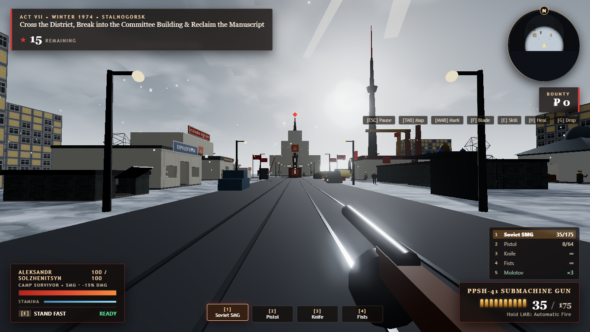
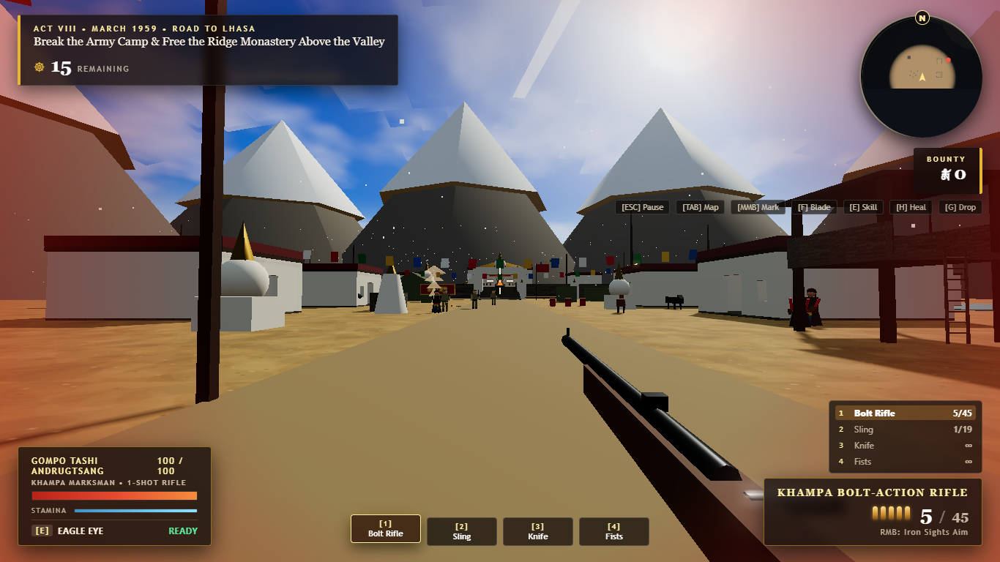
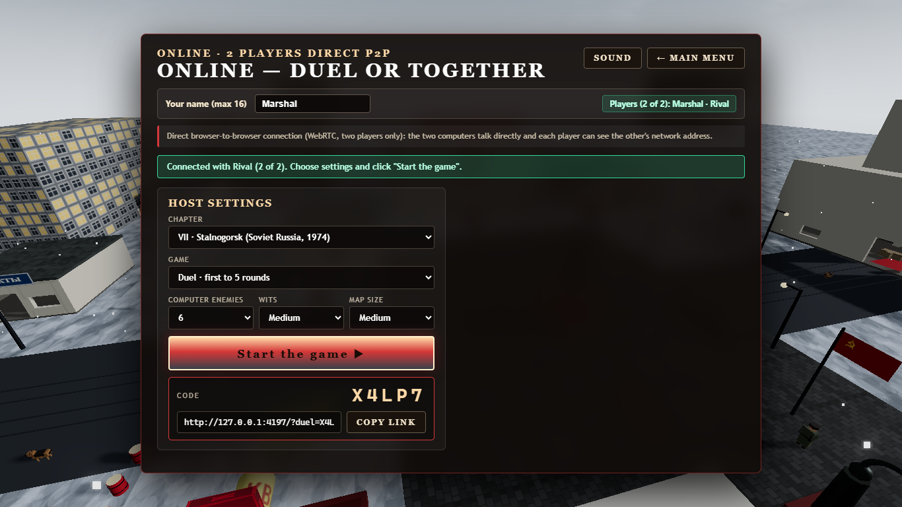
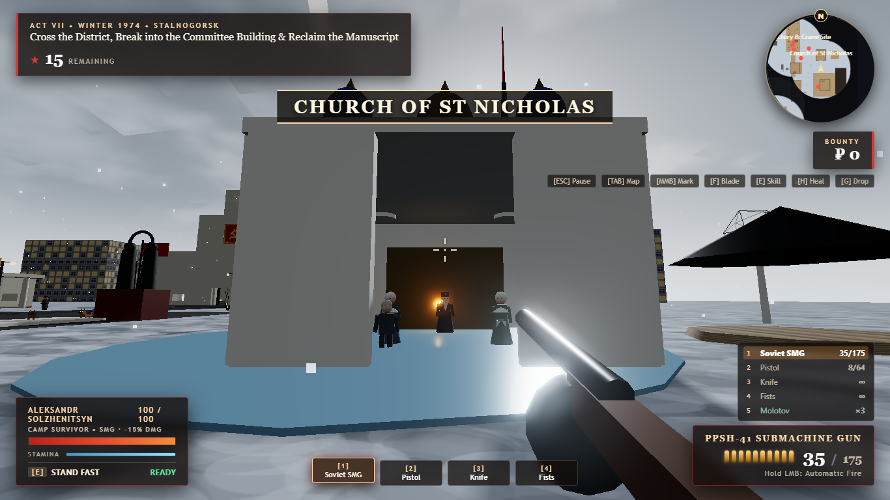

# Outlaws · Nine Horizons (Gemini version)

**Version 1.16.0** · [Changelog](CHANGELOG.md) · **[Play it in your browser](https://iago-swi.github.io/outlaws/Gemini/)**

*Nine Horizons* (*Nine frontiers — Twenty-seven legends*) is a real-time WebGL2 / Three.js 3D first-person shooter inspired by LucasArts’ 1997 spaghetti-western classic *Outlaws*, built entirely from procedural code with zero external media assets. Cross nine historical worlds — from the 1884 American West to Tenochtitlan in 1520 — entering furnished buildings, climbing ladders and towers, uncovering a fog-of-war map of 99 named landmarks, fighting enemies with selectable wits (`Low`, `Medium`, `Genius`) across three map sizes (`Small`, `Medium`, `Large`), shattering wooden props and chain-detonating powder kegs, scavenging fallen enemies' weapons, using each hero's `[E]` special skill, and playing **online for two players** directly browser-to-browser over WebRTC — either **face-to-face in a duel** or **together against the enemy**.

| Act I · Red Gulch (Wild West) | Act II · Kyoto Mist (Feudal Japan) | Act III · Rütli Valley (Switzerland) |
| :---: | :---: | :---: |
|  |  |  |
| **Act IV · Aegean Isle (Ancient Greece)** | **Act V · Fjord of the North (Scandinavia)** | **Act VI · Normandy (6 June 1944)** |
|  |  |  |
| **Act VII · Stalnogorsk (Soviet Russia, 1974)** | **Act VIII · Road to Lhasa (Tibet, 1959)** | **Act IX · Tenochtitlan (Aztec Empire, 1520)** |
|  |  |  |

| Online · direct 2-player room | Duel · choose your fighter | Duel · face to face |
| :---: | :---: | :---: |
|  |  |  |

| Chapter Map (`Tab`) with fog of war & mark | Valais Suone (Rütli Valley) | Church of St Nicholas (Stalnogorsk) |
| :---: | :---: | :---: |
|  |  |  |

---

## Playing the Game

### Title Screen, Graphics & Sound
- Every visit to the title screen picks one of the nine chapters at random for the rotating 3D flyover and matches the page's accent colour to that era.
- **Graphics quality** (bottom-left dropdown, saved across sessions): `Automatic` (default — starts on `High`, steps down only if frame rate stays under `42 fps` over 80 frames and keeps the step only if it yields at least a `7%` gain), `High`, `Medium`, or `Low`. On the pause screen press `G` to cycle quality live without reloading the chapter. Adding `?fps` to the URL shows a live corner frame-rate counter.
- **Sound Settings** (`O` from Title, Online, or Pause): independent sliders for **General**, **Effects**, **Voices**, and **Music**, plus a **Music On/Off** switch (`M` toggles music only during play).

### Nine Chapters, 27 Heroes & Cultural Landmarks
Before every single-player chapter, the **Hero Selection** screen lets you pick from three historical or legendary heroes on a live rotating 3D turntable, alongside **Enemies** (`5–30`, or up to `45` on a Large map), **Wits** (`Low`, `Medium`, `Genius`), **Map size** (`Small`, `Medium`, `Large`), and **Difficulty** (`The Good`, `The Bad`, `The Ugly`).

| Act | World, Enterable Places, Landmarks & Living World | Selectable Heroes (Strength · `[E]` Skill) | Starting Gear & Bag |
| --- | --- | --- | --- |
| **Act I · 1884**<br>*Red Gulch* | Wild West town, Boot Hill Cemetery, climbable 12 m red-rock butte, **San Xavier Mission** (twin towers, pews, altar, priest & pilgrim), railroad depot with moving steam train, mine, dust devils, cattle & horses. Enterable: Saloon, Jail, Sheriff's Office, Bank, Livery Barn, General Store, Blacksmith, Undertaker, Telegraph Office, Homestead, Crypt, crawl-in cellar den. | **Wyatt Earp** (−25% dmg · *Stand fast*) · **Calamity Jane** (+18% speed · *Dash*) · **Billy the Kid** (fast draw · *Dead eye*) | `.45 Peacemaker`, `Cavalry Sabre`, `Coach Gun`, `Henry .44`, `Fists` · Dynamite, Canteen |
| **Act II · 1603**<br>*Kyoto Mist* | Mount Fuji sanctuary, Torii avenue, Koi pond & walkable arched vermilion bridge, two-storey pagoda, **Kiri Castle** (3-storey hillside keep), tea-garden bamboo ***shishi-odoshi*** (knocks every 6 s, audible to 34 m), rice paddies, *komusō* flute monks & geisha with umbrellas. Enterable: Shrine Hall, Shoji Tea Houses, Dojo, Pagoda, Storehouse (*kura*), Bell Tower, Hermitage, crawl-in den. | **Miyamoto Musashi** (swift katana · *Fury*) · **Tomoe Gozen** (2× bow speed · *Dead eye*) · **Date Masamune** (−30% dmg · *Stand fast*) | `Shuriken` (3-star 8-point fan), `Poison Blowgun`, `Katana`, `Yumi Bow`, `Matchlock`, `Fists` |
| **Act III · 1307**<br>*Rütli Valley* | Snow-capped Alps, Lake Lucerne, **walk-behind waterfall grotto**, 100 m wooden **Valais Suone** irrigation channel (cliff plank walk, 6 trestles, meadow ditch with 5 sluices, knocking water hammer & keeper — breaking upstream wood dries downstream water), **Devil's Bridge** & goat, natural 7.5 m boulder with iron summit cross, Tell's apple, Rütli oath men, cows & goats. Enterable: Chalets, 3 Stilt Barns, Drive-Through Barn, Chapel, Watchtower, Alp Hut, crawl-in den. | **Wilhelm Tell** (fast crossbow · *Dead eye*) · **Arnold von Winkelried** (+50% HP · *Second wind*) · **Werner Stauffacher** (health regen · *Second wind*) | `Tell's Armbrust`, `Swiss Sword`, `Halberd`, `Alpine Repeater`, `Fists` · Big Stones |
| **Act IV · 480 BC**<br>*Aegean Isle* | Sunlit Cycladic village, 25-tree olive grove & oil press, bronze & golden Athena statues, mosaic floors, **Contest of the Twelve Axes** (with Odysseus's bow), sheep, goats & villagers. Enterable: Cycladic Houses, Acropolis Marble Temple, Colonnaded Villa, Stone Theatre, Fishermen's Cape & Beacon Tower, crawl-in den. | **Ulysses** (+25% javelins · *Dead eye*) · **Achilles** (−33% dmg · *Stand fast*) · **Heracles** (+60% HP · *Second wind*) | `Bronze Javelin`, `Sling`, `Xiphos Short Sword`, `Fists` · Big Stones |
| **Act V · 985 AD**<br>*Fjord of the North* | Aurora-lit snowy Norwegian fjord, **4 boardable Viking longships** (decks, bow/stern platforms, sails, rail shields, gangplanks), **The Thing Field** (law mound, 12 standing stones, lawspeaker), horned animal-skin Viking chieftains, wolves & reindeer. Enterable: Longhouses, Boat Shed, Open Smithy, Jarl's Great Hall, Farm, Temple of the Old Gods, crawl-in den. | **Erik the Red** (fast axes · *Dead eye*) · **Leif Erikson** (−33% dmg · *Stand fast*) · **Ragnar Lothbrok** (swift melee · *Fury*) | `Throwing Axe`, `Seax`, `Two-Ball Iron Flail`, `Fists` · Big Stones |
| **Act VI · 6 June 1944**<br>*Normandy* | Pre-dawn bocage lanes with 14 crawl-through hedge holes, sweeping searchlights, bombed parish church ruin with **hanging paratrooper** on the tower, Channel fleet, guard dogs & villagers. Enterable: Stone Houses, Ruined Parish Church, Farm Barn, Command Bunker, Walled Manor, rotating-sail Windmill, crawl-in den. | **Lyudmila Pavlichenko** (1-shot scoped rifle · *Eagle eye*) · **Virginia Hall** (Sten SMG + stealth · *Vanish*) · **Maurice Bavaud** (heavy pistol · *Dead eye*) | Signature firearm + chapter second firearm, `Resistance Knife`, `Fists` · Molotovs |
| **Act VII · Winter 1974**<br>*Stalnogorsk* | Snowy Soviet city with tram avenue, moving tank & car, **underground Metro station** (`10 m` down with marble columns, chandeliers, passengers & blue train), navigable **5-floor stairwell block** with furnished flats, open **Church of St Nicholas** (5 blue-and-gold onion domes, priest & worshippers), yellow **`КВАС` kvas tanker** & soda machines, Committee archive. Enterable: Food Shop, Garages, Metro, Library, Building Site & Builders' Hut, Palace of Culture, Factory, Committee Building, cellar hatch den. | **Aleksandr Solzhenitsyn** (PPSh-41, −15% dmg · *Stand fast*) · **Andrei Sakharov** (+60% pistol · *Dead eye*) · **Rudolf Nureyev** (+25% speed & stealth · *Vanish*) | Signature firearm + chapter second firearm, `Utility Knife`, `Fists` · Molotovs, Hot Tea |
| **Act VIII · March 1959**<br>*Road to Lhasa* | High ochre valley under deep blue Himalayan skies, strictly non-combatant **Dalai Lama** & caravan, white chortens, **prostrating pilgrim**, five-coloured prayer flags, **Iron Chain Bridge**, grazing yaks & dust devils. Enterable: Tibetan Houses, Village Temple, Nomad Tent, Ruined Fort, Monks' Houses, Ridge Chapel (giant spinning prayer wheel), Monastery Assembly Hall (gilded Buddha), crawl-in den. | **Gompo Tashi Andrugtsang** (1-shot bolt rifle · *Eagle eye*) · **Ani Pachen** (+20% speed · *Dash*) · **Songtsen Gampo** (bow & sword, −20% dmg · *Stand fast*) | Hero's firearm/bow, `Sling`, `Knife`/`Sword`, `Fists` · Butter Tea |
| **Act IX · 30 June 1520**<br>*Tenochtitlan* | Aztec capital on Lake Texcoco at sunset under a smoking volcano, climbable **17 m Great Temple** (twin shrines with roof combs), **Moctezuma's House of Birds** (aviary & colourful birds), canal city, three routes over the lake (causeway, chinampas, aqueduct), Spanish horsemen & cannon, market bystanders. Enterable: Palace of Axayacatl, Round Temple of Ehecatl, House of the Eagles, Mainland Village, crawl-in den. | **Cuauhtémoc** (poison darts · *Dead eye*) · **Tzilacatzin** (+50% HP · *Second wind*) · **Nezahualcóyotl** (+20% speed · *Dash*) | `Poisoned Dart-Thrower` (with feathered shield), `Blowgun`, `Macuahuitl`, `Fists` |

### Arsenal, Bag, Recoverable Missiles & Special Skills (`[E]`)
- **Finite ammo & scavenging:** Every hero starts with their own weapon, the chapter's second weapon, and **Fists** (always last, up to 6 weapons). When a weapon runs completely dry, you switch cleanly to Fists (weapons taken from fallen enemies are discarded when emptied). Fallen enemies drop their weapon, ammo boxes (from melee foes), healing items, and bombs in gunpowder eras.
- **Quick blade (`F`), Drop (`G`), Heal (`H`), Aimed throw (`RMB`):** Press `F` for an instant swing with your chapter blade; press `G` to drop your held weapon or bag item (shareable with your partner online); press `H` to heal `+35 HP` from your bag. Holding `RMB` with any thrown weapon, stone, Molotov, or bomb draws a fine **flight trajectory** that turns red when it hits an enemy. Stuck arrows, bolts, javelins, axes, knives, darts, and big stones can be pulled out and recovered where they land (up to 40 kept).
- **Seven Special Skills (`E`):** *Dash* (burst of speed), *Stand fast* (80% damage reduction), *Dead eye* (faster fire & sharper aim), *Second wind* (rapid health recovery), *Vanish* (stealth cloak — turns faint to enemies and opponents), *Fury* (rapid, harder melee strikes), and *Eagle eye* (marks enemies through walls and on the map up to 90 m).
- **Destructible world & powder kegs:** Wooden fences, tables, chairs, crates, carts, barrels, stalls, and bottles chip, darken, lean, and shatter when shot or punched (dropping any pickups resting on them to the floor). Stone, rock, iron, and trees stand firm. Red powder kegs with pale lids in the six gunpowder chapters explode in a 6 m blast and chain-detonate neighbouring kegs.

### Map, Fog of War, Wits, Map Sizes & Living World
- **Rotating mini-map & `Tab` full map:** Top-right round mini-map rotates with your heading (`N` orbits the rim). Hold `Tab` for the north-up full chapter map. Fog of war clears within 30 m of you (and your partner in co-op), naming landmarks as you arrive. Middle-click (`MMB`) places or clears a world mark with a through-wall distance readout (`◆ 42 m`).
- **Enemy Wits (`Low` / `Medium` / `Genius`):** `Low` ignores noise and stops chasing quickly; `Medium` hears gunshots/footsteps, climbs ladders, crouches low passages, and searches for 12 s; `Genius` hears much farther, alerts nearby allies, seeks crouched cover between shots, flanks, throws explosives at cover, and retreats when hurt. Enemies shout in their era's language.
- **Map Sizes (`Small` / `Medium` / `Large`):** `Small` trims the chapter with rope and red-and-white flags; `Large` expands the world `1.5×` with 7 furnished era outskirts hamlets, chimney smoke, trees, fences, extra bystanders, named landmarks, and raises the Enemies ceiling to `45`. Ground spawns are freshly randomized every run.
- **Living bystanders & animals:** 147 non-combatant bystanders go about their day, wave or greet you, put their hands up when aimed at, run for cover when fighting starts, and return once quiet. Some hurt bystanders (1 in 4 in single-player, never protected roles such as the Dalai Lama, priests, or the prostrating pilgrim) and startled or injured animals may fight back.

---

## Online: Two Players, Duel or Together

Click **Online · 2 players · duel or together** on the title screen to open a direct peer-to-peer room over **WebRTC** (two browsers talking straight to each other — PeerJS is used only for the initial 5-character handshake and disconnects immediately once connected, so zero gameplay data passes through any server). Because browsers connect directly, each player can see the other's network address.

- **5-character room codes & invite links:** Uses a 22-character unambiguous alphabet (`34679ACDEFHJKLMNPRTWXY`, no `0/O/Q`, `1/I`, `2/Z`, `5/S`, `8/B`, `G`, `U/V`), accepts lowercase and spaces, or connects straight from a `?duel=XXXXX` invite link. A third browser trying to join a full or in-progress room is turned away with a clear message.
- **Live lobby & persistent rematches:** Both players pick a display name (up to 16 characters, remembered), see `Players (2 of 2)`, and see the host's chosen **Chapter**, **Mode**, **Computer Enemies** (`None` or `3–24`), **Wits**, and **Map Size** update live. After a match ends, the connection stays open — click **Play Again (Same Connection)** to play as many matches in a row as you like with no new code.
- **Three online modes:**
  1. **Duel · first to 5 rounds:** Each kill ends a round; both restart with full health and ammo at opposite ends and swap ends every round. Choose any of the **27 heroes** or **30 duel villains**.
  2. **Duel · 7 minutes, most kills:** Wall-clock 7-minute showdown; a fallen fighter returns 3 seconds later at the end farther from the opponent.
  3. **Together against the enemy (Co-op):** Both players start side by side (`2.6 m` apart) as heroes (villains are Duel-only) against `3–24` seeded enemies plus the chapter boss, with **friendly fire off**, 5-second respawn at the start, through-wall partner distance/HP badge, shared fog-of-war uncovering, shared middle-click marks, shared `G`-dropped items, synchronized broken props, and individual kill tallies on mission completion.

### Playable Duel Villains (30 total — Duel Mode only)
No living person is included; historical dictators appear strictly without party symbols and with plain, factual descriptions.

| Act | Villains |
| --- | --- |
| **I · West** | **Jesse James** (+15% speed · *Dash*) · **Ike Clanton** (130 HP · *Second wind*) · **Belle Starr** (+30% fire rate · *Dead eye*) |
| **II · Japan** | **Oda Nobunaga** (−25% dmg · *Stand fast*) · **Sasaki Kojirō** (+2 m katana reach · *Fury*) · **Fūma Kotarō** (+20% speed · *Vanish*) |
| **III · Switzerland** | **Hermann Gessler** (−20% dmg · *Stand fast*) · **Charles the Bold** (150 HP · *Second wind*) · **Duke Leopold I** (+45% melee · *Fury*) |
| **IV · Greece** | **Polyphemus** (180 HP, giant · *Second wind*) · **Medusa** (+30% javelins · *Dead eye*) · **Antinous** (+15% speed · *Dash*) · **Minotaur** (axes & flail, 160 HP · *Second wind*) · **Xerxes** (bow & sword, −20% dmg · *Stand fast*) |
| **V · Scandinavia** | **Erik Bloodaxe** (fast axes · *Dead eye*) · **Ivar the Boneless** (−25% dmg · *Stand fast*) · **Loki** (+20% speed · *Vanish*) |
| **VI · Normandy** | **Adolf Hitler** (pistol & knife, −20% dmg · *Stand fast*) · **Benito Mussolini** (SMG & knife, 120 HP · *Second wind*) · **Hermann Göring** (scoped rifle & knife · *Eagle eye*) |
| **VII · Soviet Russia** | **Joseph Stalin** (pistol & knife, −25% dmg · *Stand fast*) · **Yuri Andropov** (+15% speed · *Dash*) · **Lavrentiy Beria** (+50% pistol · *Dead eye*) · **Leonid Brezhnev** (SMG & knife, 130 HP · *Second wind*) |
| **VIII · Tibet** | **Mao Zedong** (bolt rifle & knife, −20% dmg · *Stand fast*) · **Langdarma** (bow & sword, 140 HP · *Second wind*) · **Jiang Qing** (+20% speed · *Dash*) |
| **IX · Tenochtitlan** | **Hernán Cortés** (crossbow & halberd, −20% dmg · *Stand fast*) · **Pedro de Alvarado** (+15% speed · *Dash*) · **Nuño de Guzmán** (140 HP · *Second wind*) |

---

## Controls

| Action | Key / Input |
| --- | --- |
| Move & strafe | `W`, `A`, `S`, `D` or Arrow keys |
| Run / Jump (or stand up) | `Shift` / `Space` |
| Crouch / Sneak | `C` (or `CapsLock`) / `X` |
| Aim / Shoot, strike, throw / Scope or aimed throw | Mouse / `LMB` / `RMB` |
| Quick chapter blade | `F` |
| Reload | `R` |
| Switch weapon or bag item | `1`–`9` or Mouse Wheel |
| Use healing item from bag | `H` |
| Special skill | `E` |
| Drop held weapon or bag item | `G` |
| Place or clear map mark | Middle mouse button (`MMB`) |
| Hold open full chapter map | `Tab` |
| Music on / off | `M` |
| Sound settings | `O` |
| Pause (single-player) / Unlock mouse (online) / Back | `Esc` |
| Cycle graphics quality (while paused) | `G` (on pause screen) |

---

## Technical Notes

### Source & Build Layout (`32` source files · `29,928` lines)

| Metric | Value |
| --- | --- |
| Production bundle (`dist/`) | `index.html` `28.02 kB` (`7.39 kB` gz) · CSS `38.67 kB` (`8.25 kB` gz) · JS `1,234.15 kB` (`339.71 kB` gz) |
| Worlds & Navigation | `9` chapters · `67` enterable buildings · `33` climbable ladders · `1.0–5.8 ms` spatial-bucket 2D A\* nav-grid build per chapter |
| Living & Destructible World (Medium map) | `99` named landmarks · `147` bystanders · `21` living animals · `2,783` destructible props · `28` explosive powder kegs |
| Roster | `27` single-player heroes + `30` online duel villains (`57` playable figures with `[E]` special skills) |
| Dependencies | `three` `^0.172.0` (MIT), `peerjs` `^1.5.5` (MIT, [license](licenses/peerjs-LICENSE.txt)), `vite` `^6.0.0` (devDependency, MIT) |

### Verification — What Was Tested & What Was Not

- **Tested (automated headless Microsoft Edge WebGL2 / CDP verification against the production `dist/` bundle + visual inspection of every screenshot):**
  - All 9 chapters verified with `0` console/runtime errors: `0` unreachable enemies at `5`, `15`, and `30` enemies, all `33` ladders climbable, all crawl-in dens and `14` Normandy hedge holes crouch-passable, roof walking and drawn-geometry shot blocking verified.
  - Verified Graphics dropdown (`Automatic` / `High` / `Medium` / `Low`), mid-chapter `G` toggle, `?fps` counter, Sound Settings (`General` / `Effects` / `Voices` / `Music` + `M` music-only mute), and `Esc` menu navigation.
  - Verified full Stage 9 arsenal (finite ammo, auto-switch to Fists, bag items, Molotov fire pools, recoverable missiles, `F` quick blade, `G` drop, `RMB` red-on-target trajectory preview, and all 7 `[E]` special skills), Stage 10 mini-map / `Tab` full map / fog of war / `MMB` marks / landmarks, Stage 11 destructible props & chain-detonating powder kegs, Stage 12 `Low`/`Medium`/`Genius` enemy wits & `Small`/`Medium`/`Large` map sizes, Stage 13 living bystanders & animals, and Stage 14 Soviet underground Metro (`-10 m`), 5-floor stairwell block, Church of St Nicholas, Japan *shishi-odoshi*, Tibet prostrating pilgrim, and Swiss 100 m Valais Suone (breaking upstream wood stops downstream water).
  - **Two-tab Online verification (two tabs + a 3rd tab in one headless Edge browser over live WebRTC / PeerJS, `0` errors):** verified 5-character room codes (typed lowercase with spaces), `?duel=` invite links, 3rd-player rejection, live lobby sync, `first5` duel round swap & match completion, `timed7` 3-second respawn, 3 consecutive games over a single connection, `coop` together mode (identical seeded spawns, `2.6 m` side-by-side start, boss included, friendly fire off, individual kill credit, mission complete on both screens, shared mark, `G`-dropped weapon pickup by partner), and disconnect notification.
- **Not tested:**
  - **Two separate physical computers on different networks or behind restrictive NATs/firewalls:** Online play was tested between two browser tabs on one machine, not across two separate computers on different networks.
  - **Interactive speaker audio balance & manual hardware-GPU mouse aiming:** Web Audio and speech synthesis ran cleanly without errors in automated checks, but live speaker balance and manual mouse feel were not auditioned interactively.

### Running & Rebuilding Locally

```sh
cd Gemini
npm install
npm run dev       # Live dev server on http://localhost:5173
npm run build     # Standalone bundle in dist/ (injects version from package.json)
```
