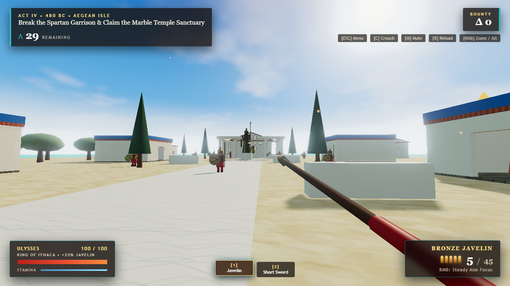
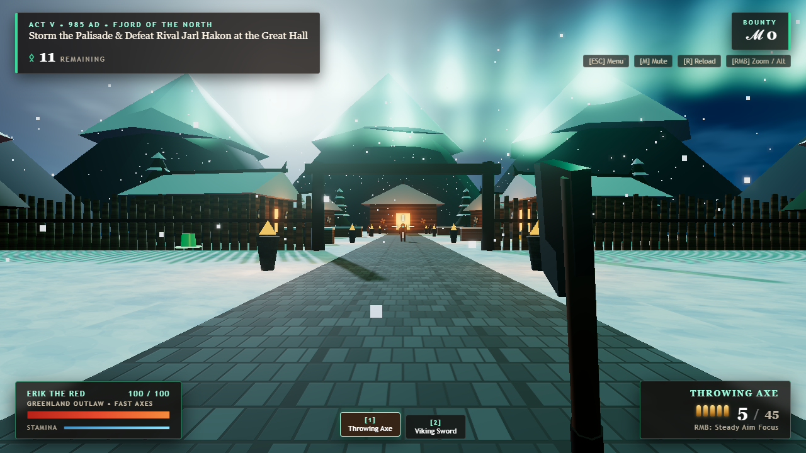

# Outlaws · Eight Horizons (Gemini version)

A real-time 3D WebGL2 first-person shooter inspired by LucasArts’ 1997 spaghetti-western classic *Outlaws*, built with **Three.js**, custom **GLSL shaders** (atmospheric skies, animated sea/lake/waterfalls, and shimmering northern lights), procedural **PBR Canvas textures**, **ACES Filmic selective bloom**, enterable hollow buildings across all eight worlds, 2D **A\* enemy route-finding**, live **3D hero selection** (24 heroes in single-player plus 25 villains in online Duel Mode), direct browser-to-browser **WebRTC Duel Mode**, and **Web Audio API** music & SFX synthesis — with zero external media assets.

**[Play it in your browser](https://iago-swi.github.io/outlaws/Gemini/)**

| Act I · Red Gulch (Wild West) | Act II · Kyoto Mist (Feudal Japan) |
| :---: | :---: |
|  |  |
| **Act III · Rütli Valley (Switzerland)** | **Act IV · Aegean Isle (Ancient Greece)** |
|  |  |
| **Act V · Fjord of the North (Scandinavia)** | **Act VI · Normandy (6 June 1944)** |
|  |  |
| **Act VII · Stalnogorsk (Soviet Russia, 1974)** | **Act VIII · Road to Lhasa (Tibet, 1959)** |
|  |  |

| Duel · choose your fighter | Duel · face to face |
| :---: | :---: |
|  |  |

## Title Screen

Every visit to the title screen picks one of the eight worlds at random for the rotating 3D background and aligns the page's accent colour and title lettering to that horizon (with elevated camera orbits clear of roofs, trees, and foliage). All eight level cards share a uniform layout (Roman numeral, title, place and year, and one line of description) distinguished only by each level's top accent bar, alongside the **Duel · two players online** and **Ride Out** controls.

## Single-Player Campaign

All eight historical frontiers — *Eight frontiers — Twenty-four legends* — can be played sequentially or selected directly from the title screen, alongside *Outlaws*-style difficulty settings (**The Good**, **The Bad**, **The Ugly**). Before every single-player level begins, a **Hero Selection Screen** displays its three historical or legendary heroes (villains never appear in single-player) on a live rotating 3D turntable — selectable with mouse hover/click or keyboard (`1`, `2`, `3`, `Enter`) — and keeps your chosen hero on retry.

| Act | Setting & Enterable Buildings | Selectable Heroes (1 strength / loadout each) | Arsenal | Enemies & Boss (Total) |
| --- | --- | --- | --- | --- |
| **Act I · 1884** — *Red Gulch* | Wild West town + **Boot Hill Cemetery** (iron fence, stone gate, graves, open grave with coffin & shovel, dead hanging tree, undertaker's cart) & **Jail** next to saloon. Enterable: **Saloon**, **Jail** (marshal office + 2 iron-barred cells solid to bodies & bullets), **Bank** (counter, barred teller cage, safe & gold bars), **Barn** (stalls, hay bales, posts), **General Store**, **Southern Homestead**, **Boot Hill Crypt** (hidden outlaw + health item). | **Wyatt Earp** (−25% damage taken) · **Calamity Jane** (+18% move speed) · **Billy the Kid** (faster fire & reload) | `.45 Peacemaker`, `10-Gauge Coach Gun`, `Henry .44 Scoped`, `Dynamite Sticks` | Outlaw Cowboys, Mexican Banditos & **El Diablo** (23) |
| **Act II · 1603** — *Kyoto Mist* | Feudal Japan sanctuary beneath Mount Fuji with Torii gates, Zen garden, Koi pond & vermilion bridge, sakura groves, bamboo forest. Enterable: **Grand Shinto Shrine Hall** (altar), walk-through **Shoji Tea Houses**, walled **Dojo Compound** with Torii gate, **Bamboo Hermitage**. | **Miyamoto Musashi** (faster katana + extra reach) · **Tomoe Gozen** (~2× Yumi Longbow speed) · **Date Masamune** (−30% damage taken) | `Muramasa Katana`, `Yumi Longbow`, `Shinobi Shuriken`, `Tanegashima Matchlock` | Shadow Ninjas, Rōnin Samurai & **Lord Kurogane** (25) |
| **Act III · 1307** — *Rütli Valley* | Medieval Switzerland encircled by snow-capped Alps, Lake Lucerne, waterfall & bridge, bearded Waldstätten halberdiers & Uri bull flag, Tell's apple. Enterable: **Swiss Chalets** (open stone ground floor), **Alpine Chapel** (altar & pews), **Habsburg Watchtower**, outlying **Alp Hut**. | **Wilhelm Tell** (40% faster crossbow reload) · **Arnold von Winkelried** (+50% max health) · **Werner Stauffacher** (out-of-danger health regen) | `Tell's Armbrust`, `Swiss Halberd`, `Alpine Repeater`, `Alpine Fire-Pot` | Austrian Halberdiers, Habsburg Arquebusiers & **Captain von Gessler** (22) |
| **Act IV · 480 BC** — *Aegean Isle* | Sunlit Greek island in a turquoise sea with olive trees, cypresses, triremes & marble Sacred Way. Enterable: **Every Cycladic Village House**, **Acropolis Marble Temple** (inner cella with great golden statue), outlying **Fishermen's Cape** (2 houses + **Beacon Tower**). | **Ulysses** (faster & harder javelins) · **Achilles** (−33% damage taken) · **Heracles** (+60% max health) | `Bronze Javelin`, `Xiphos Short Sword` | Spartan Hoplites, Spartan Javelineers (red cloaks, crested helms, Λ shields) & **Archidamos** (25) |
| **Act V · 985 AD** — *Fjord of the North* | Snowy Norwegian winter fjord beneath animated northern lights with palisade gate, longships & pines. Enterable: **Every Longhouse** (hearth & benches), **Jarl's Great Hall** (roof posts, long hearth, benches, carved high seat), outlying **Farm**, **Temple of the Old Gods**. | **Erik the Red** (faster axe throw & reload) · **Leif Erikson** (−33% damage taken) · **Ragnar Lothbrok** (faster & harder Viking Sword) | `Throwing Axe`, `Ulfberht Viking Sword` | Viking Huscarls, Bowmen, Berserkers, **4 Horned Viking Chieftains** (iron helmet with 2 ox horns & gilt band, ~2× HP), horned **Jarl Hakon** & occasional horned raiders (27) |
| **Act VI · 6 June 1944** — *Normandy* | Occupied Norman countryside before dawn under searchlights, flak bursts & Channel invasion fleet, parked tank & truck (plain bar crosses only). Enterable: ground floor of **Every Stone House**, **Parish Church** (pews & altar), **Concrete Command Bunker** (map table, radio, bunks), outlying **Walled Manor** & rotating-sail **Windmill**. | **Lyudmila Pavlichenko** (scoped bolt-action rifle, 1-shot kills on ordinary soldiers) · **Virginia Hall** (full-auto 32-round Sten SMG + stealth) · **Maurice Bavaud** (hard-hitting heavy pistol) | Hero's signature firearm + `Resistance Knife` | Occupying Riflemen, Officers, Sandbag MG Gunners, barking **Guard Dogs** & **Major Vogel** (31) |
| **Act VII · Winter 1974** — *Stalnogorsk* | Invented Soviet city under grey overcast skies & falling snow: tram-rail avenue, street lamps, five-storey panel blocks & courtyard playground, bus shelter, news kiosk, parked cars, checkpoint & militia van, cobbled square with leader statue on red granite plinth, two-workers monument, ministry slogan, park with frozen pond & bandstand, distant TV tower. Enterable: **Food Shop**, **2 Garages**, **Palace of Culture** (red seats, stage, curtains, piano), **Factory Hall** (2 smoking chimneys), **Committee Building** (pillared lobby, red carpet, barred archive cage holding seized manuscript, 3 barred cells + interrogation desk). Health item: **glass of hot tea**. | **Aleksandr Solzhenitsyn** (PPSh-41 SMG, −15% damage taken) · **Andrei Sakharov** (pistol +60% damage) · **Rudolf Nureyev** (+25% move speed & stealth) | Hero's firearm + `Utility Knife` | Committee Agents, Soviet Militia, Guard Dogs & **Colonel Voronin** (32) |
| **Act VIII · March 1959** — *Road to Lhasa* | High valley of ochre winter grass ringed by snow-capped peaks under a deep blue sky: unarmed **Dalai Lama** & caravan at start (2 monks, 2 Khampa riders, 3 horses, prayer pole — strictly non-combatant), white chortens, five-coloured prayer flags, mani wall, grazing yaks, frozen turquoise lake, black nomad tent, army camp (tents, trucks, red flag, radio mast, Chinese signboard), stone stairway with gateway chorten up to ridge monastery (white hall with dark red band, gilded roof, Dharma wheel & two deer, red pillars, prayer wheels, scripture bonfire). Enterable: **Every Tibetan Village House** (hearth, carpet bench, butter-lamp altar), **Ruined Stone Fort**, **Monks' Houses**, **Monastery Assembly Hall** (red pillars, cushions, golden Buddha, butter lamps, thangka hangings). Health item: **bowl of butter tea**. | **Gompo Tashi Andrugtsang** (bolt-action rifle with iron sights, 1-shot kills on ordinary soldiers + knife) · **Ani Pachen** (pistol + knife, +20% speed) · **Songtsen Gampo** (bow & royal sword, −20% damage taken) | Hero's loadout (`Bolt Rifle`, `Pistol`, `Bow`, `Sword` or `Knife`) | Occupying Riflemen, Machine-Gunners, club-wielding **Red Guards** & **Commander Zhao** (32) |

---

## Duel Mode: Two Players Online, Face to Face

Click **Duel · two players online** on the title screen to open the Duel Lobby. Two players on separate browsers connect directly peer-to-peer over a **WebRTC DataChannel** and fight across the full map of any of the eight levels, spawning at opposite ends (normal start vs. far boss end).

### Starting & Connecting
1. **Invite link (primary method):** The host picks the level, rules, and computer-enemy option, then clicks **Create Invite Link** to get a 5-letter code and shareable `?duel=XXXXX` URL. Opening that URL takes the guest straight into the lobby and connects automatically. Public **PeerJS** signalling (`0.peerjs.com`) is used **only** for the initial handshake; once the direct WebRTC DataChannel opens, the signalling socket disconnects so zero gameplay data passes through any server.
2. **Copy-paste codes (backup, zero outside service):** Inside the lobby's fold-out **Backup connection** section, the host generates a native WebRTC offer code and sends it via any chat app; the guest pastes it to generate a reply code; the host pastes the reply code to connect directly without any signalling server.
3. **Privacy & connection limits:** Because WebRTC connects the two browsers directly, each player can see the other's network (IP) address. Direct peer-to-peer connections work across most home networks and LANs via STUN, but strict corporate firewalls or symmetric NATs without a TURN relay may block direct UDP handshakes.

### Rules & Options
- **First to 3 rounds:** Each kill ends a round; both fighters restart with full health and ammo at opposite ends of the map and swap ends every round.
- **One life:** Single sudden-death showdown — the first kill decides.
- **5 minutes, most kills:** A 5:00 wall-clock timer counts down; a slain fighter returns 3 seconds later at whichever end of the map is farther from the opponent. Higher score wins (or **A draw** if tied).
- **Computer enemies:** **None** (players only) or **A few, hostile to both** (6 ordinary enemies from the level, simulated authoritatively by the host, attacking whichever player is closer; guest hits are sent to and decided by the host; dying to a computer enemy awards a point to the opponent).
- **Duel combat rules:** Every weapon works against the opponent (guns, bows, crossbows, thrown weapons, explosives, and blades) at **60% of normal damage** (keeping headshot multipliers and each fighter's strength). Shots, slash arcs, and thrown explosives are visible and audible on both screens. The top HUD shows the live scoreline (`You 1–0 Jesse James · round 2`) and a **compass** marking the opponent as a larger glowing dot. Duels cannot be paused; pressing `Esc` only unlocks the mouse while the duel stays live.

### Playable Duel Villains (25 total — Duel Mode only)

In Duel Mode, fighter selection displays two labelled rows: **★ Heroes** (gold star) and **☠ Villains** (red skull, red-tinted cards). Either player may choose any hero or villain. No living person is included; historical dictators are shown strictly without party symbols (no swastika, fasces, or hammer and sickle) and with plain, factual descriptions.

| Act | Villain | Description | Duel Strength & Loadout |
| --- | --- | --- | --- |
| **I · West** | **Jesse James** | Bank and train robber of Missouri. | Moves 15% faster. |
| **I · West** | **Ike Clanton** | Rustler of Tombstone, Earp's enemy at the O.K. Corral. | Starts with 130 health. |
| **I · West** | **Belle Starr** | The Bandit Queen of Indian Territory. | Fires 30% faster. |
| **II · Japan** | **Oda Nobunaga** | Warlord, the Demon King of the Sixth Heaven. | Takes 25% less damage. |
| **II · Japan** | **Sasaki Kojirō** | Musashi's rival, master of the long sword. | Extended katana reach (+2.0 m). |
| **II · Japan** | **Fūma Kotarō** | Leader of the Fūma ninja clan. | Moves 20% faster. |
| **III · Switzerland** | **Hermann Gessler** | Habsburg bailiff of Uri, of the hat on the pole. | Takes 20% less damage. |
| **III · Switzerland** | **Charles the Bold** | Duke of Burgundy, beaten at Grandson, Murten and Nancy. | Starts with 150 health. |
| **III · Switzerland** | **Duke Leopold I** | Habsburg duke, routed at Morgarten in 1315. | Harder melee blows (+45%). |
| **IV · Greece** | **Polyphemus** | The Cyclops, one-eyed giant of Homer. | 180 health, larger target (`1.36×` stature). |
| **IV · Greece** | **Medusa** | The Gorgon with living snakes for hair. | Thrown javelins fire faster and hit 30% harder. |
| **IV · Greece** | **Antinous** | Leader of the suitors in Ulysses' hall. | Moves 15% faster. |
| **V · Scandinavia** | **Erik Bloodaxe** | King of Norway, slayer of his brothers. | Throws axes much faster. |
| **V · Scandinavia** | **Ivar the Boneless** | Ragnar's son, leader of the Great Heathen Army. | Takes 25% less damage. |
| **V · Scandinavia** | **Loki** | Trickster god of Norse myth. | Moves 20% faster (mythic Norse depiction). |
| **VI · Normandy** | **Adolf Hitler** | Dictator of Nazi Germany, 1933–1945. | Pistol & knife; takes 20% less damage. |
| **VI · Normandy** | **Benito Mussolini** | Fascist dictator of Italy, 1922–1943. | Submachine gun & knife; 120 health. |
| **VI · Normandy** | **Hermann Göring** | Head of the Luftwaffe in Nazi Germany. | Scoped bolt-action rifle & knife. |
| **VII · Soviet Russia** | **Joseph Stalin** | Soviet dictator, 1924–1953. | Pistol & knife; takes 25% less damage. |
| **VII · Soviet Russia** | **Yuri Andropov** | Head of the KGB, 1967–1982. | Pistol & knife; moves 15% faster. |
| **VII · Soviet Russia** | **Lavrentiy Beria** | Stalin's chief of secret police. | Pistol hits 50% harder + knife. |
| **VII · Soviet Russia** | **Leonid Brezhnev** | Soviet leader, 1964–1982. | Submachine gun & knife; 130 health. |
| **VIII · Tibet** | **Mao Zedong** | Chairman of Communist China, 1949–1976. | Bolt-action rifle & knife; takes 20% less damage. |
| **VIII · Tibet** | **Langdarma** | Ninth-century Tibetan king who persecuted Buddhism. | Bow and sword; 140 health. |
| **VIII · Tibet** | **Jiang Qing** | Madame Mao, leader of the Gang of Four. | Pistol & knife; moves 20% faster. |

*Historical notes:*
- **Act VI (Normandy):** Lyudmila Pavlichenko, Virginia Hall, and Maurice Bavaud were real figures who resisted the Nazi regime; they did not meet in Normandy in June 1944 and appear together here as legends. Vehicles display plain military bar crosses only.
- **Act VII (Stalnogorsk):** Stalnogorsk is an invented 1974 Soviet city; Solzhenitsyn, Sakharov, and Nureyev stand together as legends.
- **Act VIII (Tibet):** Gompo Tashi Andrugtsang, Ani Pachen, and King Songtsen Gampo appear together as legends. The Dalai Lama at the start is strictly unarmed, non-targetable, and takes no part in fighting. **Red Guards** belong historically to the Cultural Revolution years after 1966 rather than 1959.

### Controls

| Action | Controls |
| --- | --- |
| Hero / fighter selection | Mouse hover/click (plus `1`, `2`, `3` and `Enter` in single-player) |
| Move & strafe | `W`, `A`, `S`, `D` or Arrow keys |
| Sprint / Jump | `Shift` / `Space` |
| Aim / Shoot / Scope or Alt-Fire | Mouse (Pointer Lock) / `LMB` / `RMB` |
| Manual reload / Switch weapons | `R` / `1`–`4` or Mouse Wheel |
| Mute / Pause (SP) or Unlock Mouse (Duel) | `M` / `Esc` |

---

## Technical notes

### Source & build layout

| Path | Responsibility |
| --- | --- |
| [index.html](index.html) & [assets/](assets/) | Pre-built standalone production bundle (`index.html` 22.0 kB / 6.1 kB gz, CSS 30.3 kB / 6.7 kB gz, JS 949.7 kB / 252.3 kB gz). |
| [src/main.js](src/main.js) | Core game loop, random title-background picker, single-player & duel hooks, Pointer Lock input, post-processing, sub-stepped movement, solid living-body separation (including opponent), wall-blocked melee LOS, and host-authoritative AI targeting. |
| [src/engine/duelNet.js](src/engine/duelNet.js) | Direct WebRTC DataChannel transport supporting both PeerJS 5-letter invite-code signalling (disconnecting signalling once connected) and zero-server native `RTCPeerConnection` copy-paste SDP offer/answer codes. |
| [src/engine/duelController.js](src/engine/duelController.js) | Duel Lobby UI, two-row Fighter Selection (`★ Heroes` / `☠ Villains`), three rule engines (`first3`, `onelife`, `timed5` with wall-clock timer & 3s respawn), 60% PvP damage relay, 6-enemy host-to-guest sync, top scoreline & compass, and disconnect handling. |
| [src/entities/villains.js](src/entities/villains.js) | Roster and party-symbol-free sculpted 3D figures for all 25 Duel villains plus unified `buildFighterFigure()` / `getFighterById()` helpers. |
| [src/entities/remoteFighter.js](src/entities/remoteFighter.js) | Live animated 3D opponent figure in Duel Mode with smooth network interpolation, walking stride, aiming pitch, melee swings, muzzle flash, head/body hit-zone tagging, floating health bar, and collapse animation. |
| [src/engine/collision.js](src/engine/collision.js) & [src/engine/buildings.js](src/engine/buildings.js) | Solid AABB collision (`STEP_MAX = 0.52 m`, iron `bars` blocking bodies & bullets), sub-stepped horizontal motion, 2D navigation grid & binary-heap **A\*** pathfinder, and hollow enterable building builder. |
| [src/engine/shaders.js](src/engine/shaders.js), [textures.js](src/engine/textures.js), [particles.js](src/engine/particles.js), [audio.js](src/engine/audio.js) | Custom GLSL sky/water/waterfall/aurora shaders, procedural Canvas PBR textures, particles, and 8-era Web Audio API music & SFX synthesis. |
| [src/entities/heroes.js](src/entities/heroes.js), [weapons.js](src/entities/weapons.js), [enemies.js](src/entities/enemies.js) | 24 single-player heroes, 26 first-person weapon viewmodels, and all 8-era enemy & boss models (including horned Viking chieftains). |
| [src/levels/level1_west.js](src/levels/level1_west.js) – [level8_tibet.js](src/levels/level8_tibet.js) | Eight enlarged 3D worlds with hollow enterable buildings, outlying areas, elevated unobstructed title-camera previews, and 217 total enemies. |

### Dependencies & Licences

| Package | Version | Purpose | Licence |
| --- | --- | --- | --- |
| `three` | `^0.172.0` | WebGL2 3D rendering, shaders, post-processing bloom | MIT |
| `peerjs` | `^1.5.5` | Optional WebRTC signalling handshake for 5-letter duel invite links | MIT ([licenses/peerjs-LICENSE.txt](licenses/peerjs-LICENSE.txt)) |
| `vite` | `^6.1.0` | Dev server & production bundler (devDependency only) | MIT |

### Verification — What Was Tested & What Was Not

- **Tested (automated two-tab headless Microsoft Edge WebGL2 / CDP verification + visual screenshot inspection):**
  - **Two-tab Duel Mode (two tabs of one browser on `http://localhost:5173`, zero console/page errors on both Host and Guest):**
    - **Invite link auto-join (Method A via PeerJS):** Host created a 5-letter invite link (`?duel=XXXXX`); Guest opened the link directly, auto-connected into a direct WebRTC DataChannel, and both entered the Duel Fighter Selection screen.
    - **Backup copy-paste codes (Method B, zero outside service):** Host generated a native WebRTC offer code, Guest generated a reply code, Host applied it, and the direct `RTCDataChannel` opened cleanly.
    - **All three rules played to their end screens:** `One life` (`You win the duel` / `You lose the duel`), `First to 3 rounds` (confirmed players swapped opposite ends between round 1 and round 2, ending at 3 kills), and `5 minutes, most kills` (confirmed 3-second respawn, Brezhnev's 130 HP & Level 7's 4 villains, and `A draw` on tied clock expiry).
    - **Both computer-enemy options:** Verified `None` (0 enemies) and `A few, hostile to both` (6 enemies synchronized across both tabs; Guest hits on an AI enemy authoritatively reduced its HP on the Host).
    - **Opponent leaving:** Guest left mid-duel; Host immediately received `Your opponent left`.
    - **Single-player regression & title screen:** Confirmed random background selection, 8 coherent level cards with top accent bars, strictly 3 heroes (0 villains) in single-player selection, and all 8 levels' building entry & 217-enemy A\* reachability.
- **Not tested:**
  - **Two separate physical computers over the public internet or behind different NAT/corporate firewalls:** All multiplayer tests ran between **two tabs of one browser on the same machine**. Real two-computer connections across restrictive NATs were not tried.
  - **Audible speaker output & live manual mouse feel:** Headless verification confirmed Web Audio initialization without errors, but live audio mix balance and hardware-GPU Pointer Lock aiming feel were not auditioned manually.

### Running & rebuilding locally

```sh
cd Gemini
copy src\index.html index.html
npm install
npm run dev       # Live dev server on http://localhost:5173
npm run build     # Standalone bundle in dist/
```
