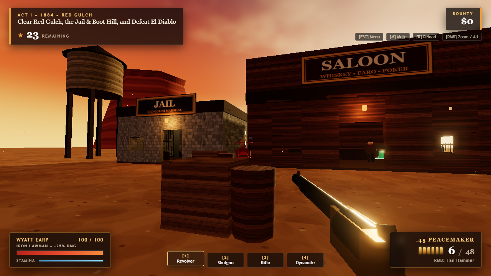
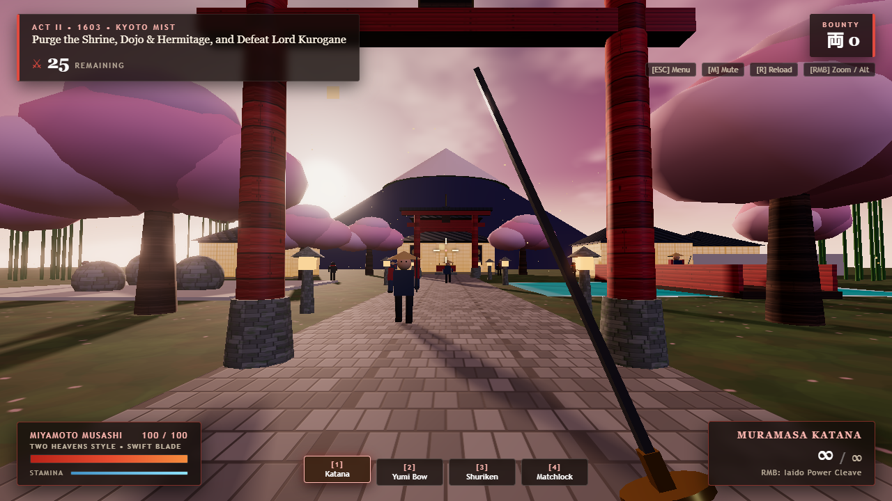
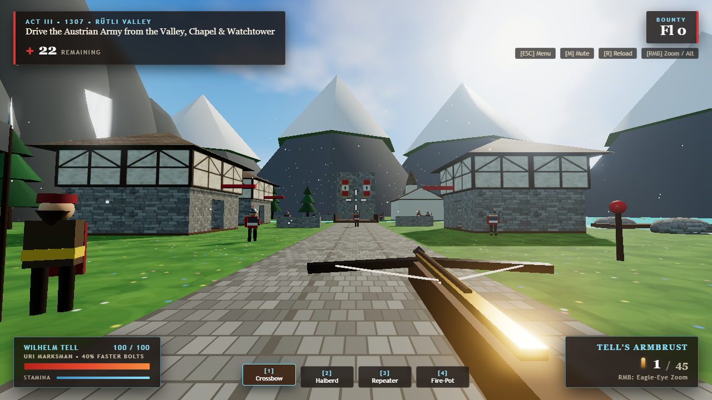
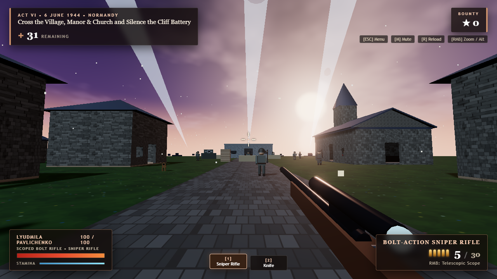

# Outlaws · Eight Horizons (Gemini version)

A real-time 3D WebGL2 first-person shooter inspired by LucasArts’ 1997 spaghetti-western classic *Outlaws*, built with **Three.js**, custom **GLSL shaders** (atmospheric skies, animated sea/lake/waterfalls, and shimmering northern lights), procedural **PBR Canvas textures**, **ACES Filmic selective bloom**, enterable hollow buildings across all eight worlds, 2D **A\* enemy route-finding**, live **3D hero selection** (24 heroes of history and legend), and **Web Audio API** music & SFX synthesis — with zero external media or CDN dependencies.

**[Play it in your browser](https://iago-swi.github.io/outlaws/Gemini/)**

| Act I · Red Gulch (Wild West) | Act II · Kyoto Mist (Feudal Japan) |
| :---: | :---: |
|  |  |
| **Act III · Rütli Valley (Switzerland)** | **Act IV · Aegean Isle (Ancient Greece)** |
|  |  |
| **Act V · Fjord of the North (Scandinavia)** | **Act VI · Normandy (6 June 1944)** |
|  |  |
| **Act VII · Stalnogorsk (Soviet Russia, 1974)** | **Act VIII · Road to Lhasa (Tibet, 1959)** |
|  |  |

## Playing the campaign

All eight historical frontiers — *Eight frontiers — Twenty-four legends* — can be played sequentially or selected directly from the live-rendered 3D title screen, alongside *Outlaws*-style difficulty settings (**The Good**, **The Bad**, **The Ugly**). Before every level begins, a **Hero Selection Screen** displays three historical or legendary figures on a live rotating 3D turntable — selectable with mouse hover/click or keyboard (`1`, `2`, `3`, `Enter`) — and keeps your chosen hero on retry.

| Act | Setting & Enterable Buildings | Selectable Heroes (1 strength / loadout each) | Arsenal | Enemies & Boss (Total) |
| --- | --- | --- | --- | --- |
| **Act I · 1884** — *Red Gulch* | Wild West town + **Boot Hill Cemetery** (iron fence, stone gate, graves, open grave with coffin & shovel, dead hanging tree, undertaker's cart) & **Jail** next to saloon. Enterable: **Saloon**, **Jail** (marshal office + 2 iron-barred cells solid to bodies & bullets), **Bank** (counter, barred teller cage, safe & gold bars), **Barn** (stalls, hay bales, posts), **General Store**, **Southern Homestead**, **Boot Hill Crypt** (hidden outlaw + health item). | **Wyatt Earp** (−25% damage taken) · **Calamity Jane** (+18% move speed) · **Billy the Kid** (faster fire & reload) | `.45 Peacemaker`, `10-Gauge Coach Gun`, `Henry .44 Scoped`, `Dynamite Sticks` | Outlaw Cowboys, Mexican Banditos & **El Diablo** (23) |
| **Act II · 1603** — *Kyoto Mist* | Feudal Japan sanctuary beneath Mount Fuji with Torii gates, Zen garden, Koi pond & vermilion bridge, sakura groves, bamboo forest. Enterable: **Grand Shinto Shrine Hall** (altar), walk-through **Shoji Tea Houses**, walled **Dojo Compound** with Torii gate, **Bamboo Hermitage**. | **Miyamoto Musashi** (faster katana + extra reach) · **Tomoe Gozen** (~2× Yumi Longbow speed) · **Date Masamune** (−30% damage taken) | `Muramasa Katana`, `Yumi Longbow`, `Shinobi Shuriken`, `Tanegashima Matchlock` | Shadow Ninjas, Rōnin Samurai & **Lord Kurogane** (25) |
| **Act III · 1307** — *Rütli Valley* | Medieval Switzerland encircled by snow-capped Alps, Lake Lucerne, waterfall & bridge, bearded Waldstätten halberdiers & Uri bull flag, Tell's apple. Enterable: **Swiss Chalets** (open stone ground floor), **Alpine Chapel** (altar & pews), **Habsburg Watchtower**, outlying **Alp Hut**. | **Wilhelm Tell** (40% faster crossbow reload) · **Arnold von Winkelried** (+50% max health) · **Werner Stauffacher** (out-of-danger health regen) | `Tell's Armbrust`, `Swiss Halberd`, `Alpine Repeater`, `Alpine Fire-Pot` | Austrian Halberdiers, Habsburg Arquebusiers & **Captain von Gessler** (22) |
| **Act IV · 480 BC** — *Aegean Isle* | Sunlit Greek island in a turquoise sea with olive trees, cypresses, triremes & marble Sacred Way. Enterable: **Every Cycladic Village House**, **Acropolis Marble Temple** (inner cella with great golden statue), outlying **Fishermen's Cape** (2 houses + **Beacon Tower**). | **Ulysses** (faster & harder javelins) · **Achilles** (−33% damage taken) · **Heracles** (+60% max health) | `Bronze Javelin`, `Xiphos Short Sword` | Spartan Hoplites, Spartan Javelineers (red cloaks, crested helms, Λ shields) & **Archidamos** (25) |
| **Act V · 985 AD** — *Fjord of the North* | Snowy Norwegian winter fjord beneath animated northern lights with palisade gate, longships & pines. Enterable: **Every Longhouse** (hearth & benches), **Jarl's Great Hall** (roof posts, long hearth, benches, carved high seat), outlying **Farm**, **Temple of the Old Gods**. | **Erik the Red** (faster axe throw & reload) · **Leif Erikson** (−33% damage taken) · **Ragnar Lothbrok** (faster & harder Viking Sword) | `Throwing Axe`, `Ulfberht Viking Sword` | Viking Huscarls, Bowmen, Berserkers, **4 Horned Viking Chieftains** (iron helmet with 2 ox horns & gilt band, ~2× HP), horned **Jarl Hakon** & occasional horned raiders (27) |
| **Act VI · 6 June 1944** — *Normandy* | Occupied Norman countryside before dawn under searchlights, flak bursts & Channel invasion fleet, parked tank & truck (plain bar crosses only). Enterable: ground floor of **Every Stone House**, **Parish Church** (pews & altar), **Concrete Command Bunker** (map table, radio, bunks), outlying **Walled Manor** & rotating-sail **Windmill**. | **Lyudmila Pavlichenko** (scoped bolt-action rifle, 1-shot kills on ordinary soldiers) · **Virginia Hall** (full-auto 32-round Sten SMG + stealth) · **Maurice Bavaud** (hard-hitting heavy pistol) | Hero's signature firearm + `Resistance Knife` | Occupying Riflemen, Officers, Sandbag MG Gunners, barking **Guard Dogs** & **Major Vogel** (31) |
| **Act VII · Winter 1974** — *Stalnogorsk* | Invented Soviet city under grey overcast skies & falling snow: wide avenue with tram rails & street lamps, five-storey panel blocks & playground (swing, rocket frame, benches, birch trees), bus shelter, news kiosk, parked cars, checkpoint & militia van, cobbled square with leader statue on red granite plinth, two-workers monument, ministry slogan, park with frozen pond & bandstand, distant TV tower. Enterable: **Food Shop**, **2 Garages**, **Palace of Culture** (red seats, stage, curtains, piano), **Factory Hall** (2 smoking chimneys), **Committee Building** (pillared lobby, red carpet, barred archive cage holding seized manuscript, wing of 3 barred cells + interrogation desk). Health item: **glass of hot tea**. | **Aleksandr Solzhenitsyn** (PPSh-41 SMG, −15% damage taken) · **Andrei Sakharov** (pistol +60% damage) · **Rudolf Nureyev** (+25% move speed & stealth) | Hero's firearm + `Utility Knife` | Committee Agents (fedora & trench coat), Soviet Militia (ushanka & burst SMG), Guard Dogs & **Colonel Voronin** (blue-band peaked cap, dual pistols) (32) |
| **Act VIII · March 1959** — *Road to Lhasa* | High valley of ochre winter grass ringed by snow-capped peaks under a deep blue sky: unarmed **Dalai Lama** & caravan at start (2 monks, 2 Khampa riders, 3 horses, prayer pole — strictly non-combatant), white chortens, five-coloured prayer flags, mani wall, grazing yaks, frozen turquoise lake, black nomad tent, army camp (tents, trucks, red flag, radio mast, Chinese signboard), stone stairway with gateway chorten up to ridge monastery (white hall with dark red band, gilded roof, Dharma wheel & two deer, red pillars, prayer wheels, scripture bonfire). Enterable: **Every Tibetan Village House** (hearth, carpet bench, butter-lamp altar), **Ruined Stone Fort**, **Monks' Houses**, **Monastery Assembly Hall** (red pillars, cushions, golden Buddha, butter lamps, thangka hangings). Health item: **bowl of butter tea**. | **Gompo Tashi Andrugtsang** (bolt-action rifle with iron sights, 1-shot kills on ordinary soldiers + knife) · **Ani Pachen** (pistol + knife, +20% speed) · **Songtsen Gampo** (bow & royal sword, −20% damage taken) | Hero's loadout (`Bolt Rifle`, `Pistol`, `Bow`, `Sword` or `Knife`) | Occupying Riflemen (khaki, soft cap, red star), Machine-Gunners, club-wielding **Red Guards** & **Commander Zhao** (32) |

*Historical notes:*
- **Act VI (Normandy):** Lyudmila Pavlichenko, Virginia Hall, and Maurice Bavaud were real figures who resisted the Nazi regime; they did not meet in Normandy in June 1944 and appear together here as legends. Vehicles display plain military bar crosses only.
- **Act VII (Stalnogorsk):** Stalnogorsk is an invented 1974 Soviet city; Aleksandr Solzhenitsyn, Andrei Sakharov, and Rudolf Nureyev stand together here as legends.
- **Act VIII (Tibet):** Gompo Tashi Andrugtsang, Ani Pachen, and King Songtsen Gampo appear together as legends. The Dalai Lama at the start is strictly unarmed, non-targetable, and takes no part in fighting. **Red Guards** are included as an iconic melee enemy type, though historically they belong to the Cultural Revolution years after 1966 rather than 1959.

### Controls

| Action | Controls |
| --- | --- |
| Hero selection | Mouse hover/click or `1`, `2`, `3` and `Enter` |
| Move & strafe | `W`, `A`, `S`, `D` or Arrow keys |
| Sprint | `Shift` (uses stamina bar) |
| Jump | `Space` |
| Aim | Mouse (Pointer Lock) |
| Fire / Throw / Melee strike | Left Mouse Button (`LMB`, hold for full-auto on Sten & PPSh-41 SMGs) |
| Sniper Scope / Iron Sights / Alt-Fire | Right Mouse Button (`RMB`) |
| Manual reload | `R` (also reloads cleanly when empty) |
| Switch weapons | `1`–`4` or Mouse Wheel |
| Mute / unmute audio | `M` |
| Pause / change hero or level | `Esc` |

---

## Technical notes

### Source & build layout

| Path | Responsibility |
| --- | --- |
| [index.html](index.html) & [assets/](assets/) | Pre-built, self-contained production bundle ready for static hosting / GitHub Pages (relative `./assets/` paths, no external CDN calls). |
| [src/main.js](src/main.js) | Core game loop, state machine (live 3D title preview, live 3D hero selection turntable, combat, pause, summary), Pointer Lock input, post-processing, sub-stepped player physics, solid living-body separation, wall-blocked melee line-of-sight, per-hero loadouts & modifiers, and boss waves. |
| [src/styles.css](src/styles.css) | Eight era-adaptive UI themes (Wild West, Japan, Switzerland, Greece, Scandinavia, Normandy, Soviet Russia, Tibet), telescopic & iron-sight aim overlays, responsive 4×2 level-card grid, and hero selection UI. |
| [src/engine/collision.js](src/engine/collision.js) | Solid AABB spatial collision solver (`STEP_MAX = 0.52m` climbable stairs vs. walls, iron `bars` blocking both bodies and bullets, `water` blocking bodies only), sub-stepped horizontal motion (`<= 0.22m` per sub-step so fast runners never tunnel thin walls), slab raycasting, automatic 2D navigation-grid builder (`buildNavGrid(1.35)` from exact collision boxes), and binary-heap **A\* pathfinder** (`findPath`, `canReach`). |
| [src/engine/buildings.js](src/engine/buildings.js) | Reusable hollow enterable room builder (`buildHollowRoom`) splitting walls geometrically around real open doorways (`>= 1.9m` wide) and open/barred windows, climbable exterior steps, iron-barred cell walls (`buildBarredWall`), and solid interior furniture (desks, bunks, pews, altars, hearths, stoves, upright pianos). |
| [src/engine/shaders.js](src/engine/shaders.js) | Custom GLSL shaders: 3-band atmospheric scattering sky dome with solar halo & FBM clouds, Fresnel water shader, cascading alpine waterfall shader, and additive animated **Aurora Borealis** curtain shader. |
| [src/engine/textures.js](src/engine/textures.js) | Procedural HTML5 Canvas PBR texture generator (albedo + bump maps) including wood planks, desert/moss/Zen/meadow/Aegean/snow/ochre terrains, stone/marble/concrete, five-storey Soviet apartment panels, Cyrillic & Chinese banners, Tibetan *thangka* wall hangings, Western signs & Wanted posters, heraldic banners, Spartan Λ shields, Viking shields, and plain bar-cross vehicle markings. |
| [src/engine/particles.js](src/engine/particles.js) | Ambient particle fields (dust, sakura petals, alpine mist, snowfall), tumbleweeds, waterfall & factory-chimney smoke plumes, tracers, slash arcs, sparks, and explosion shockwaves. |
| [src/engine/audio.js](src/engine/audio.js) | Real-time Web Audio API procedural synthesizer generating eight era soundtracks — including a slow minor waltz with trembling balalaika, wind, crow & distant tram bell (Act VII), and Tibetan long horns, singing bowl, temple bells, 5-note flute, wind & snapping flags (Act VIII) — plus weapon, impact, explosion, dog-bark, and boss-horn SFX. |
| [src/entities/heroes.js](src/entities/heroes.js) | Roster of 24 historical/legendary heroes with sculpted 3D turntable figures, single-strength modifiers, and hero-specific weapon loadouts in Acts VI–VIII. |
| [src/entities/weapons.js](src/entities/weapons.js) | 26 articulated 3D first-person weapon viewmodels across all eight eras (adding Soviet PPSh-41 SMG, Makarov pistol, Khampa bolt-action rifle, Tibetan pistol, Tibetan recurve bow, and royal Tibetan broadsword). |
| [src/entities/enemies.js](src/entities/enemies.js) | Articulated 3D enemies across all eight eras — adding horned **Viking Chieftains** (plus horned Jarl & random horned Vikings), Committee Agents, Soviet Militia, Colonel Voronin, PLA Riflemen & Machine-Gunners, Red Guards, and Commander Zhao — with A\* route-finding, sub-stepped movement, wall-blocked melee, safe death fall direction (falling into clear space or slumping in place instead of clipping into walls), and ambush hiding (Boot Hill crypt outlaw). |
| [src/levels/level1_west.js](src/levels/level1_west.js) – [level8_tibet.js](src/levels/level8_tibet.js) | Eight enlarged 3D levels with hollow enterable buildings, outlying areas, solid prop collisions, custom pickups (including hot tea glasses in Act VII and butter tea bowls in Act VIII), and 217 total enemies (23, 25, 22, 25, 27, 31, 32, 32). |

### Rendering, performance & verification

- **Engine**: `Three.js` (`^0.172.0`) on WebGL2 with `PCFSoftShadowMap` (`2048×2048` directional shadow maps) and `ACESFilmicToneMapping` (`exposure: 1.12`).
- **Post-Processing**: `EffectComposer` running `RenderPass` → `UnrealBloomPass` (selective threshold `0.82`, radius `0.55`, strength `0.34`) → `OutputPass`.
- **Production bundle size**: `index.html` (`13.4 kB`, gzip `4.1 kB`), CSS (`21.6 kB`, gzip `5.2 kB`), JS (`801.2 kB`, gzip `212.7 kB`) — zero external media or CDN calls.
- **Measured load & nav-grid build times** (headless Microsoft Edge + SwiftShader software WebGL2, `1280×720`):
  - Act I: `255 ms` (175 colliders, 14,518 nav cells, 23 enemies)
  - Act II: `452 ms` (132 colliders, 13,804 nav cells, 25 enemies)
  - Act III: `109 ms` (120 colliders, 9,856 nav cells, 22 enemies)
  - Act IV: `153 ms` (143 colliders, 11,554 nav cells, 25 enemies)
  - Act V: `292 ms` (127 colliders, 11,990 nav cells, 27 enemies)
  - Act VI: `197 ms` (134 colliders, 12,317 nav cells, 31 enemies)
  - Act VII: `122 ms` (150 colliders, 15,750 nav cells, 32 enemies)
  - Act VIII: `165 ms` (151 colliders, 15,750 nav cells, 32 enemies)

#### What was tested vs. what could not be tested
- **Tested (automated headless Edge WebGL2 / CDP verification + visual inspection of all 8 screenshots):**
  - Production `vite build` succeeds cleanly with 0 errors.
  - Title screen renders all 8 level cards and `"Eight frontiers — Twenty-four legends"`.
  - All 8 levels load cleanly with 0 WebGL context losses and visually verified `1280×720` screenshots (no black frames or bloom NaNs).
  - **Building entry verified in every level:** walking from outside through open doorways into the Saloon (L1), Shinto Shrine Hall (L2), Alpine Chapel (L3), Marble Temple Cella (L4), Jarl's Great Hall (L5), Parish Church (L6), Food Shop (L7), and Tibetan Village House (L8) via sub-stepped `moveHorizontal()`.
  - **100% enemy reachability verified:** `collision.canReach(spawnPos, enemy.spawnPos)` passed for all 217 enemies (including all 8 bosses) across all 8 levels (`0` unreachable enemies).
  - **Specific mechanics verified:** Level 1 Jail iron bars block bullets (`hasLineOfSight === false`) and bodies; Level 1 Boot Hill crypt hides 1 ambush outlaw until close; Level 5 spawns exactly 4 horned `viking_chieftain`s; all 6 new heroes in Levels 7–8 apply their exact weapon loadouts and strength modifiers.
- **Not directly tested in this headless environment:**
  - Live audible Web Audio API playback through physical speakers (audio nodes initialize without errors, but headless Edge has no speaker output to audition musical balance).
  - Full manual playthrough with hardware GPU frame-rate profiling and real-mouse Pointer Lock aim feel across all 8 bosses to the end screen.

### Running & rebuilding locally

**Play directly (no build needed):** Serve the repository root or the `Gemini/` folder with any static HTTP server:

```sh
python -m http.server 8000 --bind 127.0.0.1
```

Then open `http://127.0.0.1:8000/Gemini/` in your browser.

**Rebuild from source (Node.js + Vite):**

```sh
cd Gemini
copy src\index.html index.html
npm install
npm run dev       # Live dev server on http://localhost:5173
npm run build     # Outputs standalone bundle to dist/
```
