# Outlaws

> [!NOTE]
> **Development is back in this repository.** [raphfleury](https://github.com/raphfleury) continued the Claude game (*Lone Hand*) in [his own repository](https://github.com/raphfleury/Outlaws) from version 1.5.0 to 2.5.0: a game together for two players, a map, an arsenal, living bystanders and much else.
> Since version 2.6.0 the game is developed here again, with all of his work in it.

Two browser games inspired by LucasArts’ 1997 Western *Outlaws*, built to compare what different AI assistants produce from the same brief. Both take you through nine frontiers: the American West, feudal Japan, central Switzerland, ancient Greece, Viking Scandinavia, Normandy on 6 June 1944, a Soviet city in the winter of 1974, the Tibetan plateau in March 1959, and Tenochtitlan, the Aztec capital, on 30 June 1520.

**Play it in your browser: <https://iago-swi.github.io/outlaws/>**

| Version | Play | Source and controls |
| --- | --- | --- |
| Claude · Lone Hand | [Play](https://iago-swi.github.io/outlaws/Claude/) | [Claude/](Claude/) |
| Gemini · Nine Horizons | [Play](https://iago-swi.github.io/outlaws/Gemini/) | [Gemini/](Gemini/) |
| Claude · Lone Hand, Blender trial | [Play](https://iago-swi.github.io/outlaws/Claude-Blender/) | [Claude-Blender/](Claude-Blender/) |

The third row is a trial, not a third game: Lone Hand 2.7.0 with the people and the houses of three chapters (Dry Gulch, Kagemori, Uri) modelled in Blender. Its README shows [before and after](Claude-Blender/comparison.jpg).

To play offline, download or clone this repository and open `index.html` in your browser. It is a landing page that links to both versions. Each version is self-contained in its own folder, with its own README.

## Claude version

| Chapter I · Dry Gulch | Chapter II · Kagemori | Chapter III · Uri |
| :---: | :---: | :---: |
|  |  |  |
| **Chapter IV · Ithaca** | **Chapter V · Jarnvik** | **Chapter VI · Sainte-Aubine** |
|  |  |  |
| **Chapter VII · Stalnogorsk** | **Chapter VIII · Che La** | **Chapter IX · Tenochtitlan** |
| 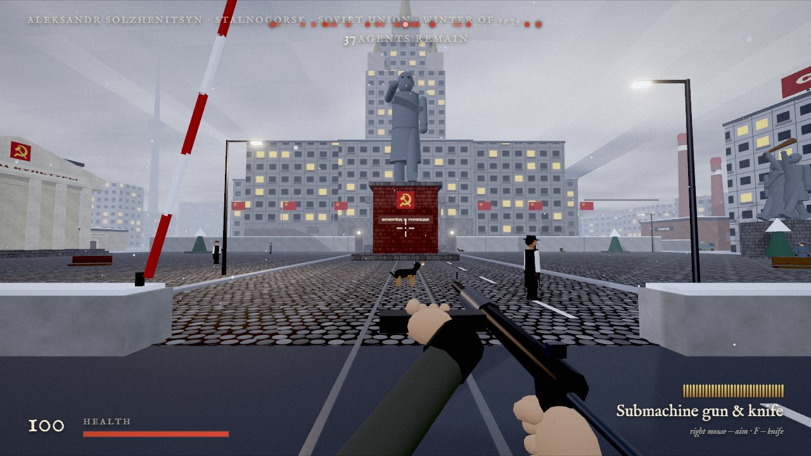 |  | 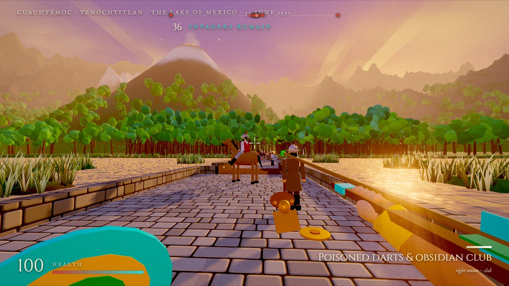 |

| Online · the invite | Duel · choose your fighter | Duel · face to face |
| :---: | :---: | :---: |
| 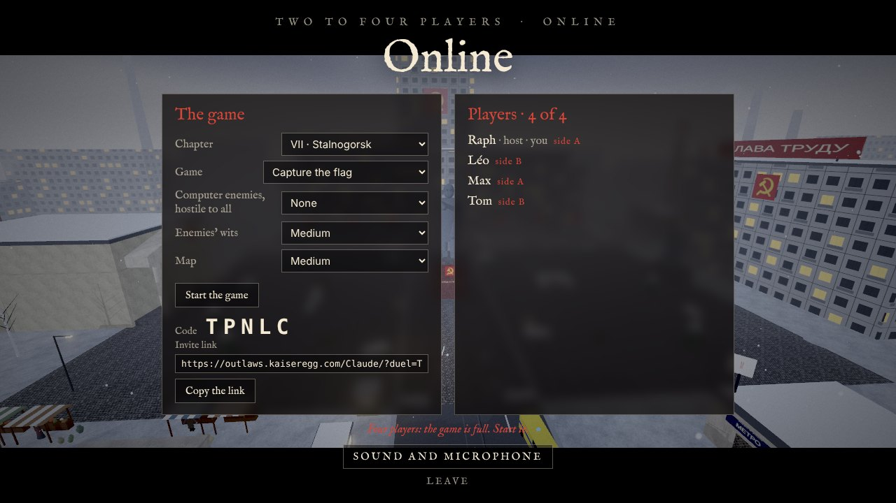 |  |  |

| Uri · the Suone | Below Stalnogorsk · the metro |
| :---: | :---: |
| 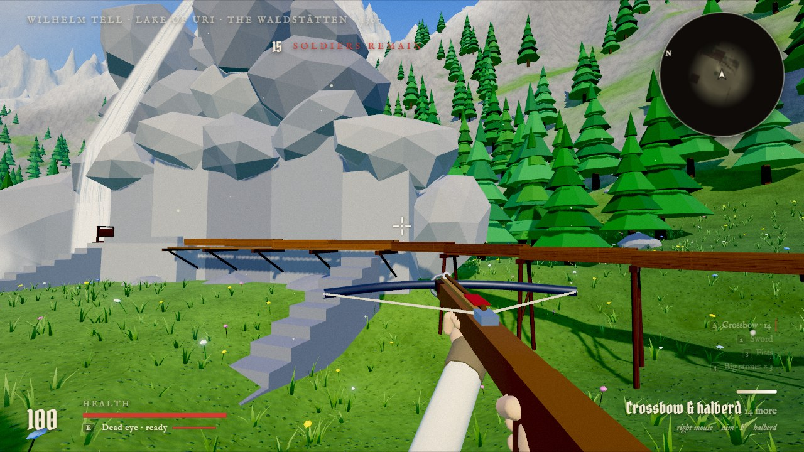 | 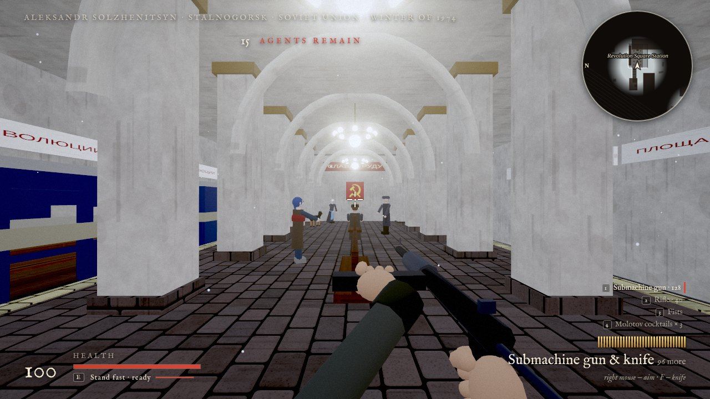 |
| **Inside the church of St Nicholas** | **The map, with the places found** |
|  |  |

*Lone Hand* is a free-roaming 3D shooter in nine chapters, with every texture, model and sound generated by code. Each chapter starts with a choice of three heroes from history and legend, twenty-seven in all, among them Wyatt Earp, Miyamoto Musashi, Wilhelm Tell, Ulysses, Erik the Red, Lyudmila Pavlichenko, Andrei Sakharov, Gompo Tashi Andrugtsang and Cuauhtémoc, each with their own look and one strength. Most buildings can be entered and are furnished, four Viking longships can be boarded, a path leads behind the waterfall of Uri, an irrigation channel (the Suone) runs from it to the meadows with a plank to walk along the rock face, and every chapter offers several ways to the enemy. About 160 people who take no part in the fight, half of them women, go about their day: a woman keeps the bar in Dry Gulch, three men swear the oath on the Rütli, Penelope weaves in Ithaca, Norse women hang cod on the racks, nuns turn the prayer wheels of Che La, market women sell in Tenochtitlan. You can crouch, climb 62 ladders onto roofs, towers, scaffolds and rocks, crawl through hedges and drains and under wagons, and walk up a butte by steps of rock, for an ambush or a sniper's nest. A chapter holds 5 to 30 enemies (45 on a large map), as you choose, and they think as cleverly as you choose: dull, medium or genius, from those who only fight back to those who hide, call each other, climb after you and throw bombs at where you hide. The map can be small, medium or large, with hamlets round a large one. Every hero sets out with two weapons and a special skill. Landmarks get their names on the map as you find them, enemies shout at you in their own languages, and in Stalnogorsk you can go down into the metro, up a stairwell to five floors of flats, and into an Orthodox church. Weapons can be taken from fallen enemies and changed with the mouse wheel, healing items and bombs kept in a bag, places marked on a map, fences, furniture, carts, crates and powder kegs shot to pieces; bystanders run for cover when shooting starts, and some of them, like some animals, fight back when hurt. Two players can play online, each in their own browser, connected directly to each other: a duel, or together against the enemy, as a hero or as one of thirty villains. **[Play it in your browser](https://iago-swi.github.io/outlaws/Claude/)**, or download the repository and open `Claude/index.html`. [Controls and technical notes](Claude/README.md) · [Changelog](Claude/CHANGELOG.md), version 2.7.0

## Gemini version

| Act I · Red Gulch | Act II · Kyoto Mist | Act III · Rütli Valley |
| :---: | :---: | :---: |
|  |  | 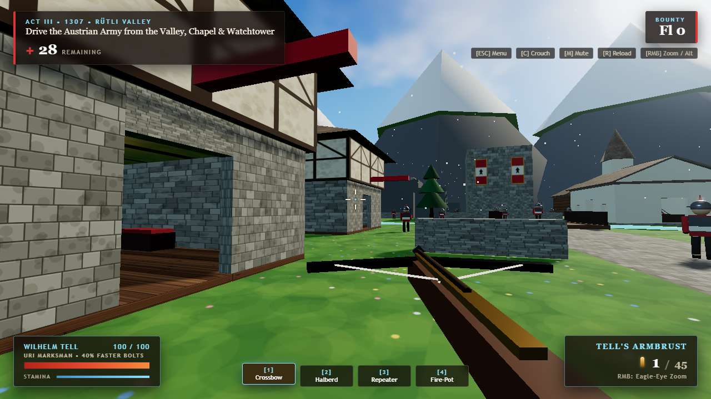 |
| **Act IV · Aegean Isle** | **Act V · Fjord of the North** | **Act VI · Normandy** |
|  |  |  |
| **Act VII · Stalnogorsk** | **Act VIII · Road to Lhasa** | **Act IX · Tenochtitlan** |
|  |  | 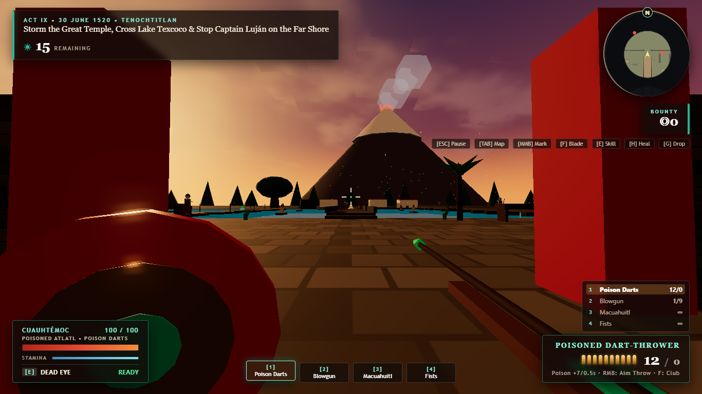 |

| Online · direct 2-player room | Duel · choose your fighter | Duel · face to face |
| :---: | :---: | :---: |
|  | 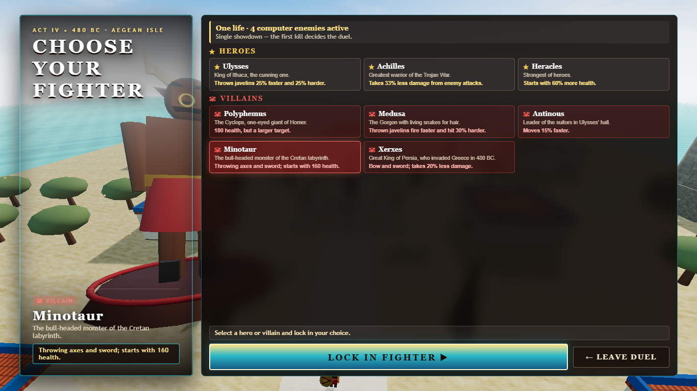 | 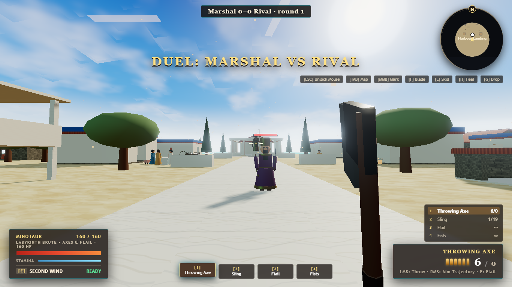 |

| Chapter Map (`Tab`) | Valais Suone (Rütli Valley) | Church of St Nicholas (Stalnogorsk) |
| :---: | :---: | :---: |
| 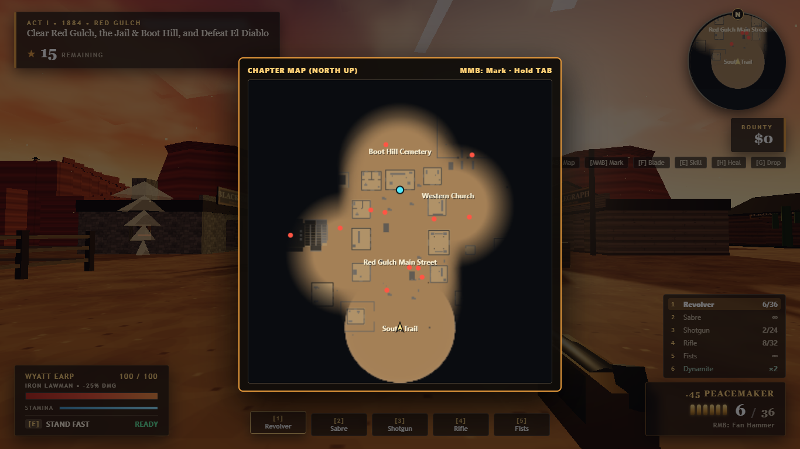 | 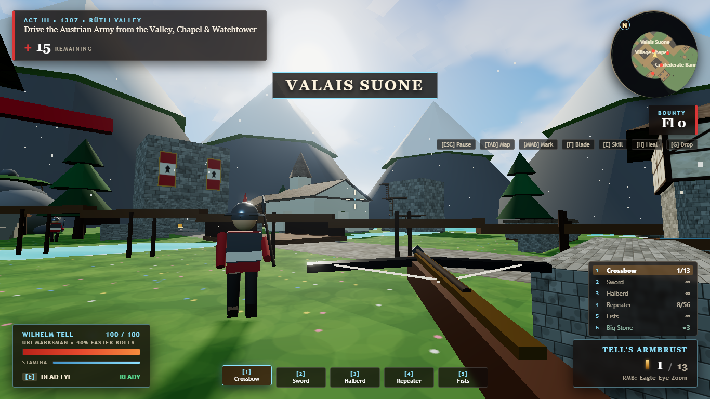 |  |

*Nine Horizons* is a real-time WebGL2 / Three.js 3D first-person shooter across nine eras, featuring 67 enterable hollow buildings, 33 climbable ladders, crouching (`C`), sneaking (`X`), 99 named landmarks on a fog-of-war rotating mini-map and `Tab` full map with middle-click marking, 2,783 destructible wooden props and 28 chain-detonating powder kegs, finite ammo with scavenged enemy weapons, bag items (heals, big stones, Molotovs, bombs), recoverable missiles, 7 hero `[E]` special skills, selectable enemy wits (`Low`, `Medium`, `Genius`) with era voices, three map sizes (`Small`, `Medium`, `Large` with 7 outskirts hamlets and up to 45 enemies), 147 living bystanders and 21 animals, cultural landmarks in every chapter (including Stalnogorsk's underground Metro, 5-floor stairwell block, and open Church of St Nicholas, Kyoto's bamboo *shishi-odoshi*, Tibet's prostrating pilgrim, and Rütli Valley's 100 m Valais *Suone*), automatic/manual graphics settings, four-channel sound settings, and direct peer-to-peer **WebRTC Online Play** for two players — either **face-to-face duels** (first to 5 rounds or 7 minutes, with 27 heroes and 30 villains) or **together against the enemy** with shared map, marks, drops, and persistent rematches. **[Play it in your browser](https://iago-swi.github.io/outlaws/Gemini/)**, or serve the repository locally and open `Gemini/index.html`. [Controls and technical notes](Gemini/README.md) · [Changelog](Gemini/CHANGELOG.md), version 1.16.0

## Game history

**1997 — Outlaws.** LucasArts released *Outlaws*, a first-person shooter set in the Old West, on an enhanced version of the engine it had built for *Dark Forces*. Retired marshal James Anderson hunts the gang that killed his wife and took his daughter. The game is remembered for its hand-drawn animated story scenes, for Clint Bajakian’s score in the manner of the Italian Westerns, and for making the player reload by hand. It is often credited as one of the first shooters with a sniper scope. [The game on Wikipedia](https://en.wikipedia.org/wiki/Outlaws_(1997_video_game)) · [Gameplay video](https://www.youtube.com/watch?v=9n4ghEkKV-Q)

**1998 — Handful of Missions.** LucasArts followed with a free add-on of further single-player missions and multiplayer maps.

**2025 — The remaster.** Nightdive Studios brought the game and its add-on back as *Outlaws + Handful of Missions: Remaster*, with higher-resolution art and support for current systems. [The remaster on Steam](https://store.steampowered.com/app/3366780/Outlaws_Handful_of_Missions_Remaster/)

**2026 — Lone Hand.** The frontiers are open 3D places to walk through: the main street of Dry Gulch at golden hour, a path of torii gates through a bamboo forest, and a valley on the Lake of Uri. The gunslinger carries a six-shooter, the samurai throwing stars and a katana, and the crossbowman of Uri a crossbow and a halberd. Two further chapters followed: a Greek island held by Spartans, fought with javelins and a short sword, and a Norwegian fjord under the northern lights, fought with throwing axes. A sixth is set in Normandy before dawn on 6 June 1944: three people who resisted the Nazi regime, with a scoped rifle, a Sten gun and a pistol, cross hedgerows and a guarded village to silence a coastal battery. Two more chapters and a rebuilt world followed: a grey Soviet city in the winter of 1974, held by the KGB, and the road south of Lhasa in March 1959, where the player clears the way for the Dalai Lama's escape. Many buildings can now be entered, among them the saloon, the jail and the bank of Dry Gulch; walls and bodies are solid, and enemies find their own way round walls and through doors. A Duel mode then set two players against each other online, with villains from Jesse James to the Cyclops to choose beside the heroes. A further round opened most buildings, moored four longships to board at Jarnvik, cut a path behind the waterfall of Uri, and put flute monks, geisha, golden Buddhas, the hammer and sickle and three more Greek villains into the world. The latest round added crouching, a climbable butte and knoll, roofs and hides reached by jumping, and dens with crawl-in doors. The church of Dry Gulch then opened its door, with a stair inside the tower up to the bell. Ladders then replaced the crates to jump on: face one and walk, and you climb; and the knoll of Uri became a natural boulder with a summit cross, reached by a ladder that leans against it. The hero screen then gained an Enemies list (10 to 30, or all of them), and the arrow keys now move exactly like W A S D. A ninth chapter followed: Tenochtitlan at sunset on 30 June 1520, with the Great Temple to climb, a causeway over the lake, jungle, a smoking volcano, Spanish horsemen and a cannon, and a poisoned dart-thrower. Then all nine worlds grew: back doors and upper floors, a railroad and a mine in Dry Gulch, rice paddies in Kagemori, the Rütli and a lake landing in Uri, a city of canals in place of the jungle of Tenochtitlan, holes to crawl through the hedgerows of Normandy; and people moved in who take no part in the fight, half of them women, each at their work. A chapter now holds thirty enemies at most. Later rounds made everything but stone breakable, from bottles to wooden walls, and gave the fists something to hit; let the bystanders take fright, talk to the player and fall; put a limit on every weapon's ammunition, with boxes to find; uncovered the map as it is explored, with places to mark; let the player take the weapons of fallen enemies and carry things in a bag; and opened games for two online: a duel in five rounds or seven minutes, capture the flag, and together against the enemy (version 1.9). Version 2.0 gave the enemies three levels of wits and ears to hear with, the maps three sizes with hamlets round the large one, every hero a second weapon and a special skill, new weapons (knife, sword, sabre, halberd, sling, blowgun, big stones, Molotov cocktails), and missiles to pick up again where they fell. Version 2.1 named the places of every chapter, shared the map and the marks between two players together, made roofs to stand on and stopped shots at what is drawn, took Stalnogorsk below ground into a metro station and up a stairwell of five floors, opened an Orthodox church with its priest, gave the enemies voices in their own languages, set the bystanders to work, and redrew the sky and the textures. Version 2.2 put a game server between the players, so that a game online connects from any network, and opened it to four players, two against two or all together. Version 2.3 let the animals be hurt and killed, set some of them and some bystanders against the player who hurts them, put every bystander to some occupation, and made the flight line of thrown weapons fine, and red on a target. Version 2.4 set a bamboo deer scarer knocking in the tea garden of Kagemori and a pilgrim going round a chorten of Che La by prostrations. Version 2.5 gave every chapter a place of its culture or its time: a Spanish mission, a Japanese castle, the Devil's Bridge, the contest of the bow, a thing field, a paratrooper hanging from a church tower, a kvas tanker, an iron chain bridge and Moctezuma's house of birds. Version 2.6 led an irrigation channel, the Suone, from the waterfall of Uri to its meadows, with a hammer that knocks as long as the water runs. Version 2.7 took the game server away again: two players connect directly to each other, for a duel or a game together. [Explore the Claude edition](Claude/)

**2026 — Nine Horizons.** Built with Three.js, custom GLSL shaders, procedural PBR textures, 67 hollow enterable buildings, 33 climbable ladders, spatial-bucket 2D A\* route-finding, and Web Audio synthesis, *Nine Horizons* spans nine eras with live 3D hero selection (27 heroes, each with a strength, two weapons, and an `[E]` special skill), finite ammo and scavenged enemy weapons, bag items (heals, big stones, Molotovs, bombs), recoverable missiles, 2,783 destructible wooden props and chain-detonating powder kegs, a rotating mini-map and `Tab` full map with fog of war, 99 named landmarks, and middle-click marks, three levels of enemy wits with era voices, three map sizes (up to 45 enemies with outskirts hamlets), 147 living bystanders and 21 animals, cultural landmarks in every chapter (including Stalnogorsk's underground Metro, 5-floor stairwell block, and open Church of St Nicholas, Kyoto's bamboo *shishi-odoshi*, Tibet's prostrating pilgrim, and Rütli Valley's 100 m Valais *Suone*), automatic/manual graphics and four-channel sound settings, and direct two-player WebRTC online play — either face-to-face duels (30 playable villains) or together against the enemy with shared map, marks, drops, and persistent rematches (version 1.16.0). [Explore the Gemini edition](Gemini/)

## Structure

```text
outlaws/
|-- Claude/    # version built with Claude: game, source code, screenshots, technical README
|-- Claude-Blender/ # trial: Lone Hand with people and houses of three chapters modelled in Blender
|-- Gemini/    # version built with Gemini
|-- index.html # shared landing page
`-- README.md
```
