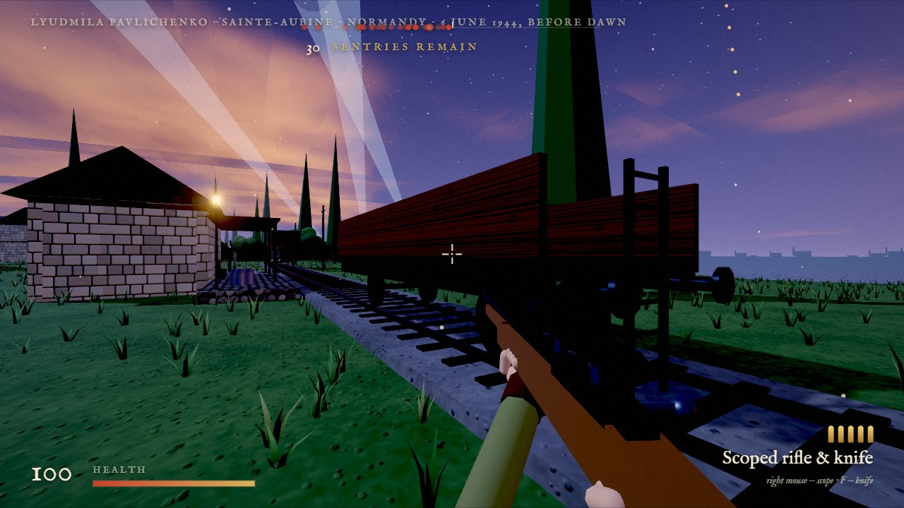
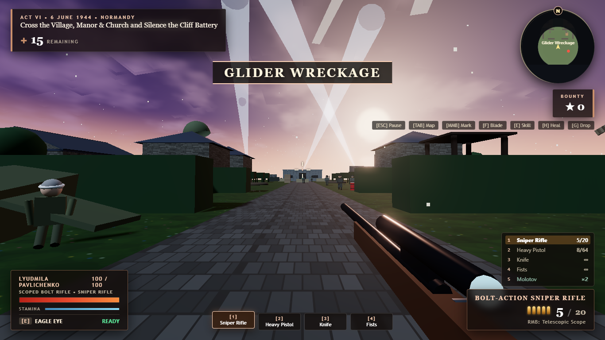

# Outlaws

Two browser games inspired by LucasArts’ 1997 Western *Outlaws*, built to compare what different AI assistants produce from the same brief. Both take you through eight frontiers: the American West, feudal Japan, central Switzerland, ancient Greece, Viking Scandinavia, Normandy on 6 June 1944, a Soviet city in the winter of 1974, and the Tibetan plateau in March 1959.

**Play it in your browser: <https://iago-swi.github.io/outlaws/>**

| Version | Play | Source and controls |
| --- | --- | --- |
| Claude · Lone Hand | [Play](https://iago-swi.github.io/outlaws/Claude/) | [Claude/](Claude/) |
| Gemini · Eight Horizons | [Play](https://iago-swi.github.io/outlaws/Gemini/) | [Gemini/](Gemini/) |

To play offline, download or clone this repository and open `index.html` in your browser. It is a landing page that links to both versions. Each version is self-contained in its own folder, with its own README.

## Claude version

| Chapter I · Dry Gulch | Chapter II · Kagemori |
| :---: | :---: |
|  |  |
| **Chapter III · Uri** | **Chapter IV · Ithaca** |
|  |  |
| **Chapter V · Jarnvik** | **Chapter VI · Sainte-Aubine** |
|  |  |
| **Chapter VII · Stalnogorsk** | **Chapter VIII · Che La** |
|  |  |

| Duel · choose your fighter | Duel · face to face |
| :---: | :---: |
|  |  |

*Lone Hand* is a free-roaming 3D shooter in eight chapters, with every texture, model and sound generated by code. Each chapter starts with a choice of three heroes from history and legend, twenty-four in all, among them Wyatt Earp, Miyamoto Musashi, Wilhelm Tell, Ulysses, Erik the Red, Lyudmila Pavlichenko, Andrei Sakharov and Gompo Tashi Andrugtsang, each with their own look and one strength. A Duel mode lets two players fight each other online, each in their own browser, as a hero or as one of twenty-five villains. **[Play it in your browser](https://iago-swi.github.io/outlaws/Claude/)**, or download the repository and open `Claude/index.html`. [Controls and technical notes](Claude/README.md)

## Gemini version

| Act I · Red Gulch | Act II · Kyoto Mist |
| :---: | :---: |
|  |  |
| **Act III · Rütli Valley** | **Act IV · Aegean Isle** |
|  |  |
| **Act V · Fjord of the North** | **Act VI · Normandy** |
|  |  |
| **Act VII · Stalnogorsk** | **Act VIII · Road to Lhasa** |
|  |  |

*Eight Horizons* is a real-time WebGL2 / Three.js 3D first-person shooter across eight eras, featuring enterable hollow buildings across every level, solid physics and 2D A\* enemy route-finding, custom GLSL atmospheric skies and northern lights, animated sea, lake and waterfall shaders, procedural Canvas PBR textures, ACES Filmic selective bloom, and procedural Web Audio soundtracks. Each level begins with a live 3D hero selection screen offering three figures from history and legend — twenty-four in all, including Wyatt Earp, Miyamoto Musashi, Wilhelm Tell, Ulysses, Erik the Red, Lyudmila Pavlichenko, Aleksandr Solzhenitsyn, and Gompo Tashi Andrugtsang — each with a distinct 3D figure and one strength or signature loadout. **[Play it in your browser](https://iago-swi.github.io/outlaws/Gemini/)**, or serve the repository locally and open `Gemini/index.html`. [Controls and technical notes](Gemini/README.md)

## Game history

**1997 — Outlaws.** LucasArts released *Outlaws*, a first-person shooter set in the Old West, on an enhanced version of the engine it had built for *Dark Forces*. Retired marshal James Anderson hunts the gang that killed his wife and took his daughter. The game is remembered for its hand-drawn animated story scenes, for Clint Bajakian’s score in the manner of the Italian Westerns, and for making the player reload by hand. It is often credited as one of the first shooters with a sniper scope. [The game on Wikipedia](https://en.wikipedia.org/wiki/Outlaws_(1997_video_game)) · [Gameplay video](https://www.youtube.com/watch?v=9n4ghEkKV-Q)

**1998 — Handful of Missions.** LucasArts followed with a free add-on of further single-player missions and multiplayer maps.

**2025 — The remaster.** Nightdive Studios brought the game and its add-on back as *Outlaws + Handful of Missions: Remaster*, with higher-resolution art and support for current systems. [The remaster on Steam](https://store.steampowered.com/app/3366780/Outlaws_Handful_of_Missions_Remaster/)

**2026 — Lone Hand.** The frontiers are open 3D places to walk through: the main street of Dry Gulch at golden hour, a path of torii gates through a bamboo forest, and a valley on the Lake of Uri. The gunslinger carries a six-shooter, the samurai a bow and a katana, and the crossbowman of Uri a crossbow and a halberd. Two further chapters followed: a Greek island held by Spartans, fought with javelins and a short sword, and a Norwegian fjord under the northern lights, fought with throwing axes. A sixth is set in Normandy before dawn on 6 June 1944: three people who resisted the Nazi regime, with a scoped rifle, a Sten gun and a pistol, cross hedgerows and a guarded village to silence a coastal battery. Two more chapters and a rebuilt world followed: a grey Soviet city in the winter of 1974, held by the KGB, and the road south of Lhasa in March 1959, where the player clears the way for the Dalai Lama's escape. Many buildings can now be entered, among them the saloon, the jail and the bank of Dry Gulch; walls and bodies are solid, and enemies find their own way round walls and through doors. A Duel mode then set two players against each other online, with villains from Jesse James to the Cyclops to choose beside the heroes. [Explore the Claude edition](Claude/)

**2026 — Eight Horizons.** Built with Three.js, custom GLSL shaders, procedural PBR textures, hollow enterable buildings, 2D A\* enemy route-finding, and Web Audio synthesis, *Eight Horizons* spans all eight eras with live 3D hero selection (twenty-four heroes in all), twenty-six era weapons, and eight boss showdowns — from Red Gulch (with saloon, iron-barred jail, bank, barn, homestead, and Boot Hill cemetery), Kyoto Mist, and Rütli Valley to the marble Aegean Isle, the aurora-lit Norwegian fjord with horned Viking chieftains, pre-dawn Normandy on 6 June 1944, snowy Soviet Stalnogorsk in 1974, and the road south of Lhasa in March 1959. [Explore the Gemini edition](Gemini/)

## Structure

```text
outlaws/
|-- Claude/    # version built with Claude: game, source code, screenshots, technical README
|-- Gemini/    # version built with Gemini
|-- index.html # shared landing page
`-- README.md
```
