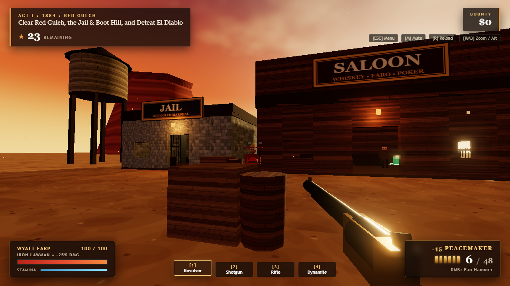

# Outlaws

Two browser games inspired by LucasArts’ 1997 Western *Outlaws*, built to compare what different AI assistants produce from the same brief. Each takes you through three frontiers: the American West, Japan and central Switzerland.

**Play it in your browser: <https://iago-swi.github.io/outlaws/>**

## Claude version

| Chapter I · Dry Gulch | Chapter II · Kagemori | Chapter III · Uri |
| --- | --- | --- |
|  |  |  |

*Lone Hand* is a free-roaming 3D shooter in three chapters, with every texture, model and sound generated by code. Each chapter starts with a choice of three heroes from history and legend, among them Wyatt Earp, Miyamoto Musashi and Wilhelm Tell, each with their own look and one strength. **[Play it in your browser](https://iago-swi.github.io/outlaws/Claude/)**, or download the repository and open `Claude/index.html`. [Controls and technical notes](Claude/README.md)

## Gemini version

| Act I · Red Gulch | Act II · Kyoto Mist | Act III · Rütli Valley |
| --- | --- | --- |
|  |  |  |

*Three Horizons* is a real-time WebGL2 / Three.js 3D first-person shooter across three eras, featuring custom GLSL atmospheric skies, animated water and cascading waterfalls, procedural Canvas PBR textures, ACES Filmic selective bloom, vintage sniper optics, manual reloading, and procedural Web Audio soundtracks. **[Play it in your browser](https://iago-swi.github.io/outlaws/Gemini/)**, or serve the repository locally and open `Gemini/index.html`. [Controls and technical notes](Gemini/README.md)

## Game history

**2026 — Lone Hand.** The three frontiers are open 3D places to walk through: the main street of Dry Gulch at golden hour, a path of torii gates through a bamboo forest, and a valley on the Lake of Uri. The gunslinger carries a six-shooter, the samurai a bow and a katana, and the crossbowman of Uri a crossbow and a halberd. [Explore the Claude edition](Claude/)

**2026 — Three Horizons.** Built with Three.js, custom GLSL shaders, procedural PBR textures, and Web Audio synthesis, *Three Horizons* pairs each era with four distinct 3D weapons and a boss showdown — Marshal Anderson in Red Gulch, Kenshin the Samurai beneath Mount Fuji, and Wilhelm Tell alongside bearded Waldstätten halberdiers flying the Uri bull flag in Rütli Valley. [Explore the Gemini edition](Gemini/)
