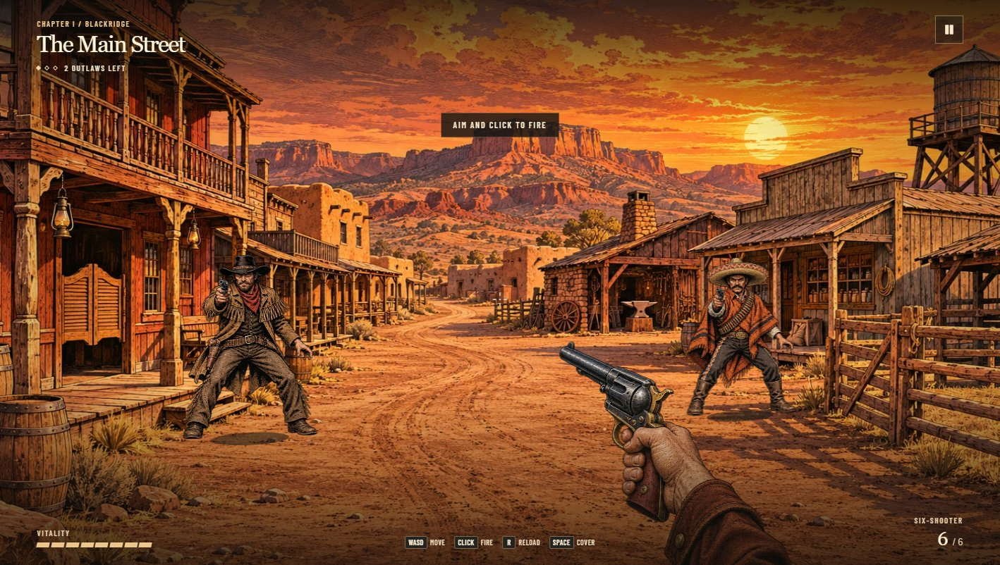

# Outlaws

Two independent browser games inspired by LucasArts’ 1997 Western *Outlaws*, built in separate versions to compare what different AI assistants produce from the same brief. Both take you through three frontiers: a town of the American West, a shrine in Japan, and the valleys of Uri.

| Version | Source, controls and technical notes |
| --- | --- |
| Claude · Lone Hand | [Claude/](Claude/) |
| ChatGPT · Three Frontiers | [ChatGPT/](ChatGPT/) |

To play offline, download the repository using **Code → Download ZIP**, extract it, and open the root `index.html`. It is a landing page that links to both versions. Each version is self-contained in its own folder, with its own README.

## Claude version


*Lone Hand* is a free-roaming 3D shooter in three chapters, with every texture, model and sound generated by code. Open `Claude/index.html` to play it directly. [Controls and technical notes](Claude/README.md)

## ChatGPT version



*Three Frontiers* is an illustrated shooter of nine first-person encounters, from a New Mexico saloon to a Japanese shrine and the mountain passes of Uri. Open `ChatGPT/index.html` to play it directly. [Controls and technical notes](ChatGPT/README.md)

## Game history

**1997 — Outlaws.** LucasArts cast the player as James Anderson, a retired U.S. marshal pursuing the gang that killed his wife and kidnapped his daughter. The game brought the Western into a first-person shooter through animated story sequences, dusty frontier towns, and a score by Clint Bajakian. Manually reloading the revolver gave a gunfight a distinctive rhythm. [Original game history](https://en.wikipedia.org/wiki/Outlaws_(1997_video_game)) · [Atari’s retrospective](https://atari.com/products/outlaws-handful-of-missions-remaster)

**1998 — Handful of Missions.** LucasArts expanded the game with additional missions. Nightdive later included this expansion alongside the original campaign. [Nightdive’s announcement](https://www.youtube.com/watch?v=qx4O0OmaFNg)

**2025 — The remaster.** Nightdive Studios released *Outlaws + Handful of Missions: Remaster* on November 20. The team revisited archived art to recreate characters, weapons, and enemies in higher resolution, and added cross-platform multiplayer. [Official release page](https://store.steampowered.com/app/3366780/Outlaws_Handful_of_Missions_Remaster/)

**2026 — Three Frontiers.** This project began with the idea of a short browser shootout in the spirit of *Outlaws*. Its original campaign follows three different protagonists. A gunslinger takes back Blackridge with a six-shooter, a samurai clears the road to a shrine with a katana, and a bearded Waldstätter bearing Uri’s colors faces Austrian soldiers with a halberd. [Explore the ChatGPT edition](ChatGPT/)

**2026 — Lone Hand.** The same brief produced a second game. Here the three frontiers are open 3D places to walk through: the main street of Dry Gulch at golden hour, a path of torii gates through a bamboo forest, and a valley on the Lake of Uri. The gunslinger carries a six-shooter, the samurai a bow and a katana, and the crossbowman of Uri a crossbow and a halberd. [Explore the Claude edition](Claude/)

## Repository structure

```text
outlaws/
├── Claude/       Game, source code, screenshots and technical README
├── ChatGPT/      Game, artwork, screenshot and technical README
├── index.html    Version selection
└── README.md     Project overview and game history
```
